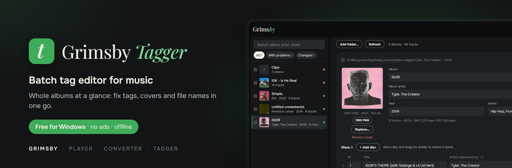
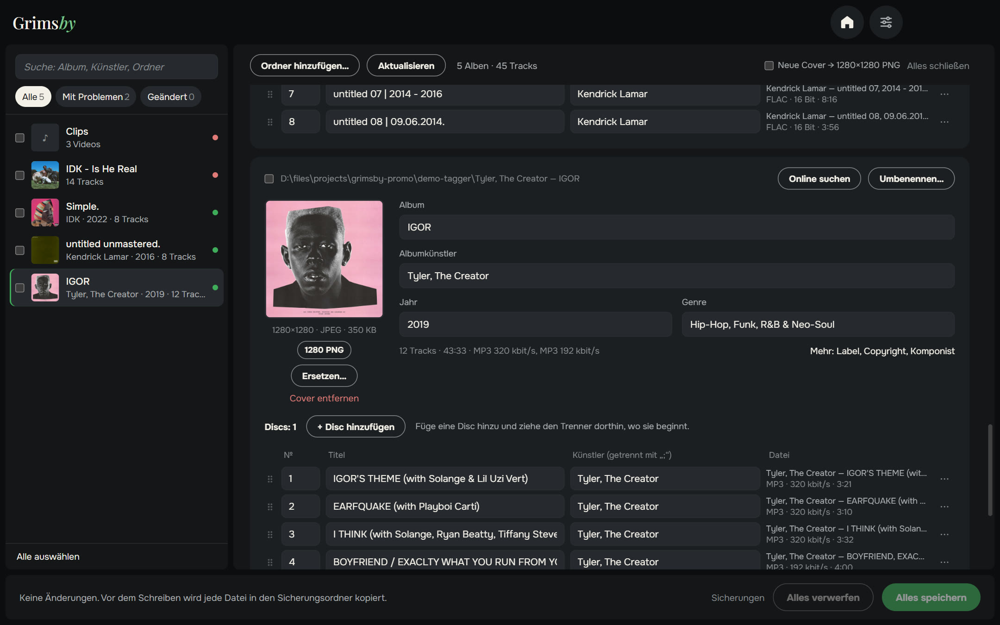
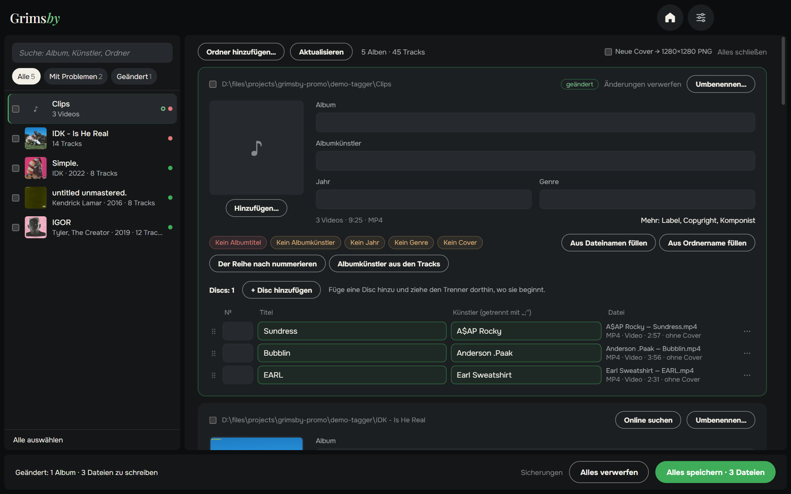
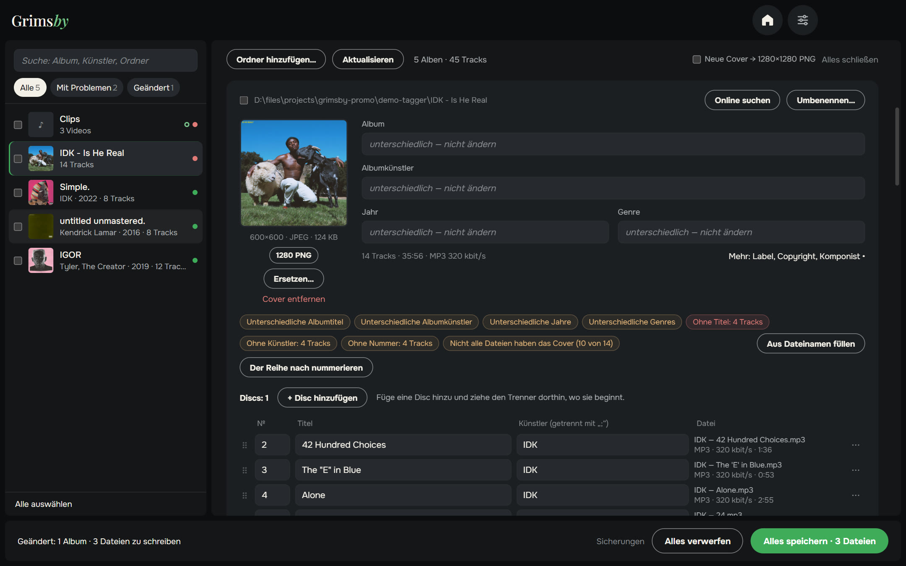
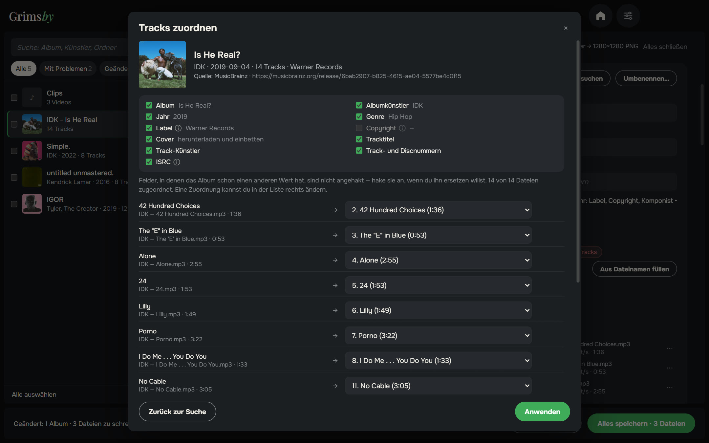
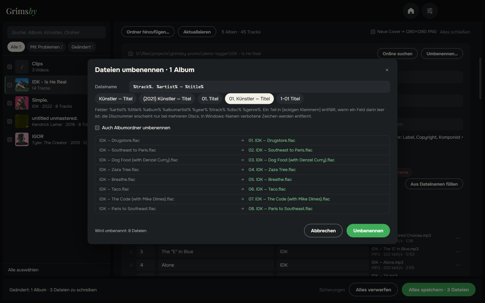
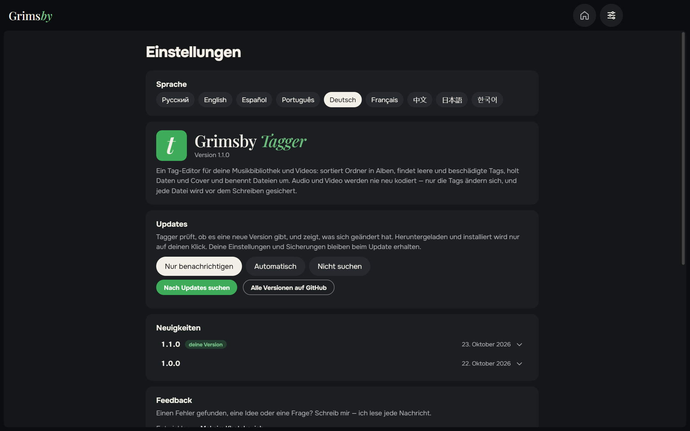
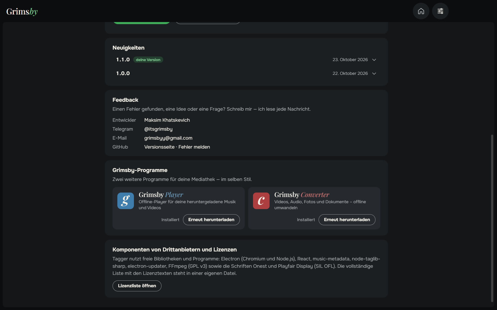

  <a href="README.md">English</a> ·
  <a href="README.ru.md">Русский</a> ·
  <a href="README.es.md">Español</a> ·
  <a href="README.pt.md">Português</a> ·
  <b>Deutsch</b> ·
  <a href="README.fr.md">Français</a> ·
  <a href="README.zh.md">中文</a> ·
  <a href="README.ja.md">日本語</a> ·
  <a href="README.ko.md">한국어</a>

  

  <b>Bring die Tags deiner ganzen Musikbibliothek in Ordnung – albumweise statt Datei für Datei.</b> 
  Alle Probleme auf einen Blick, mit ein paar Klicks behoben und mit einem Klick gespeichert. Jetzt auch für Videos.

  
  
  
  
  

  <a href="https://github.com/maksimkhatskevich/grimsby-tagger/releases/latest"><b>⬇ Für Windows herunterladen</b></a>
  &nbsp;·&nbsp;
  <a href="#funktionen">Funktionen</a>
  &nbsp;·&nbsp;
  <a href="#deine-dateien-sind-sicher">Sicherheit</a>
  &nbsp;·&nbsp;
  <a href="#feedback">Feedback</a>

---

## Warum Grimsby Tagger

Tags lassen eine Sammlung im Player gut aussehen: das richtige Album, Jahr, Interpret, Titelnummern und Cover. Heruntergeladene Musik kommt selten perfekt an – einem Album fehlt das Jahr, einem anderen das Cover, beim dritten sind Zeichen kaputt. Klassische Tag-Editoren zeigen eine Tabelle mit Tausenden Dateien, die man Zeile für Zeile korrigiert.

**Grimsby Tagger denkt in Alben.** Wähle einen Ordner beliebiger Tiefe – er sortiert die Dateien in Alben, zeigt jedes als Karte mit Cover und hebt hervor, was nicht stimmt. Bearbeite, was du willst, und klicke auf **Alles speichern** (Strg+S).

---

## Funktionen

### 💿 Alben ordnen sich selbst

Ein Album ist ein Ordner plus das Tag „Album“. Mehrere Alben in einem Ordner werden getrennt, CD1/CD2-Unterordner zu einem Album zusammengeführt, Dateien ohne Tags dem Album ihres Ordners zugeordnet. Normale und Deluxe-Edition aus einem Ordner werden eine Karte. Ein Titel im falschen Album? Zieh ihn ins richtige – beim Speichern bekommt er dessen Tags und Cover und wandert in dessen Ordner.

### 🎬 Auch Videos

Musikvideos, Konzerte und andere Clips werden wie Musik bearbeitet – stapelweise, direkt in den Karten: MP4, M4V, WMV, MKV, WebM und MOV. Das Video wird nie neu kodiert – nur die Tags und, wo das Format es erlaubt, das Cover ändern sich.

### 🩺 Probleme auf einen Blick

Unlesbare Dateien, leere Felder, uneinheitliche Werte im Album, doppelte Nummern, fehlende oder kleine Cover, kaputte Zeichen alter Kodierungen, beschädigte Tags. Fahr mit der Maus über den Hinweis, um zu sehen, was falsch ist und wie man es behebt; **Tags neu schreiben** repariert beschädigte. Der Filter **„Mit Problemen“** zeigt nur Alben, die Aufmerksamkeit brauchen.

### 🪄 Korrekturen mit einem Klick

Sie füllen nur Leeres aus und überschreiben nichts:

- Titel, Interpreten und Nummern aus Dateinamen wie `01. Interpret — Titel`;
- Album, Interpret und Jahr aus dem Ordnernamen `Interpret — Album (2021)`;
- Nummerierung der Reihe nach, Albuminterpret aus den Titeln;
- Zeichenkodierung reparieren, `cover.jpg` aus dem Ordner einbetten.

### 🌐 Album online finden

Füge einen Link zum Album bei einem Musikdienst ein – oder tippe einfach `Interpret — Album`. Grimsby findet die Veröffentlichung in offenen Musikdatenbanken, **ordnet die Titel deinen Dateien zu** – nach Titel, Länge und Nummer – und lässt dich wählen, welche Felder übernommen werden. Felder mit einem anderen Wert bleiben standardmäßig unverändert.

### ✏️ Nach Vorlage umbenennen

Vorlagen wie `%artist% — %title%` oder `[%disc%-]%track% %title%`, auf Wunsch auch für Albumordner. Vorschau, Prüfung auf Duplikate – und **Umbenennen rückgängig machen**, falls du es dir anders überlegst.

### 📦 Stapelbearbeitung und mehr

- Mehrere Alben ankreuzen → Albuminterpret, Jahr, Genre oder Label für alle auf einmal setzen; zu einem Album zusammenführen.
- Zusätzliche Felder: Label, Copyright, Komponist, Kommentar, ISRC, Songtext.
- Cover: ersetzen, ein Bild daraufziehen, in voller Größe ansehen, quadratisch zuschneiden, auf den Standard 1280×1280 PNG bringen oder von der gefundenen Veröffentlichung laden.

### ⚙️ Einstellungen auf einer Seite

Sprache, Updates (nur melden, automatisch oder nicht prüfen), Neuigkeiten, Feedback und die anderen Grimsby-Apps – alles auf einer Seite. Das Fenster merkt sich Größe und Position.

🌍 **9 Sprachen:** Englisch, Russisch, Spanisch, Portugiesisch, Deutsch, Französisch, Chinesisch, Japanisch und Koreanisch – umschalten in den Einstellungen, sofort wirksam.

---

## Deine Dateien sind sicher

- Es werden nur Tags geschrieben – **Audio und Video werden nie neu kodiert**.
- Vor dem Bearbeiten wird jede Datei in einen Sicherungsordner kopiert (14 Tage aufbewahrt).
- Nach dem Schreiben wird die Datei erneut gelesen. Öffnet sie sich nicht oder hat sich die Länge geändert, wird das Original automatisch wiederhergestellt.

Musik: MP3, FLAC, M4A (AAC/ALAC), OGG, Opus, WAV, AIFF, APE, WavPack, WMA und DSF. Video: MP4, M4V, WMV, MKV, WebM und MOV.

---

## Herunterladen und installieren

1. Öffne die Seite der **[neuesten Version](https://github.com/maksimkhatskevich/grimsby-tagger/releases/latest)** und lade das Installationsprogramm `.exe` herunter.
2. Starte es. Windows zeigt eventuell ein blaues Fenster „Der Computer wurde durch Windows geschützt“ – eine normale Warnung für Programme ohne kostenpflichtiges Signaturzertifikat. Klicke auf **Weitere Informationen → Trotzdem ausführen**.
   Das Installationsprogramm wurde bei VirusTotal geprüft: [keiner der 67 Virenscanner schlägt an](https://www.virustotal.com/gui/file/e4dfabdb0c5f60a9fc7c6c42132a6e3492d6ef2414fcf21a93ebd759987a35e0) (Version 1.1.0).
3. Klicke auf **Ordner hinzufügen…** oder zieh deinen Musikordner ins Fenster.

**Voraussetzungen:** Windows 10 oder 11 (64 Bit). Internet wird nur für die Albumsuche gebraucht.

---

## Datenschutz

Grimsby Tagger arbeitet auf deinem Computer. Kein Konto, keine Werbung, keine Analyse. Online geht er nur, wenn du selbst ein Album suchst, und für die Update-Prüfung.

---

## Grimsby-Apps

<table>
  <tr>
    <td align="center" width="33%"><a href="https://github.com/maksimkhatskevich/grimsby-releases/blob/main/README.de.md"> <b>Grimsby Player</b></a> Offline-Player für deine heruntergeladene Musik und Videos</td>
    <td align="center" width="33%"><a href="https://github.com/maksimkhatskevich/grimsby-converter/blob/main/README.de.md"> <b>Grimsby Converter</b></a> Videos, Audio, Fotos und Dokumente – offline umwandeln</td>
    <td align="center" width="33%"> <b>Grimsby Tagger</b> </td>
  </tr>
</table>

---

## Feedback

Einen Fehler gefunden, eine Idee oder einfach Danke sagen? Schreib mir:

- ✉️ E-Mail: **[grimsbyy@gmail.com](mailto:grimsbyy@gmail.com)**
- 🐞 Fehler und Ideen: [Issues](https://github.com/maksimkhatskevich/grimsby-tagger/issues)
- 📣 Telegram: [@itsgrimsby](https://t.me/itsgrimsby) (auf Russisch)

---

## Lizenzen

Grimsby Tagger nutzt Open-Source-Komponenten, darunter Electron, React, music-metadata und TagLib#. Die vollständige Liste mit Lizenztexten steht in `THIRD_PARTY_NOTICES.txt` im Programmordner. Albumcover in den Screenshots gehören ihren Rechteinhabern und zeigen eine persönliche Bibliothek als Beispiel.

© 2026 Grimsby

