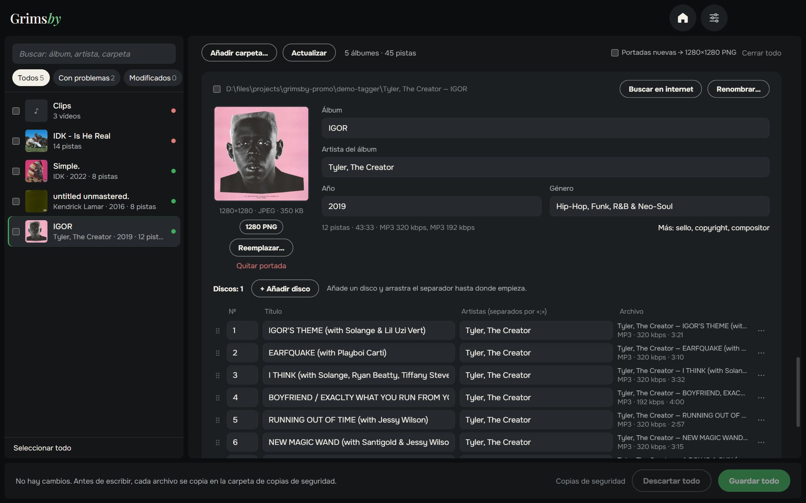
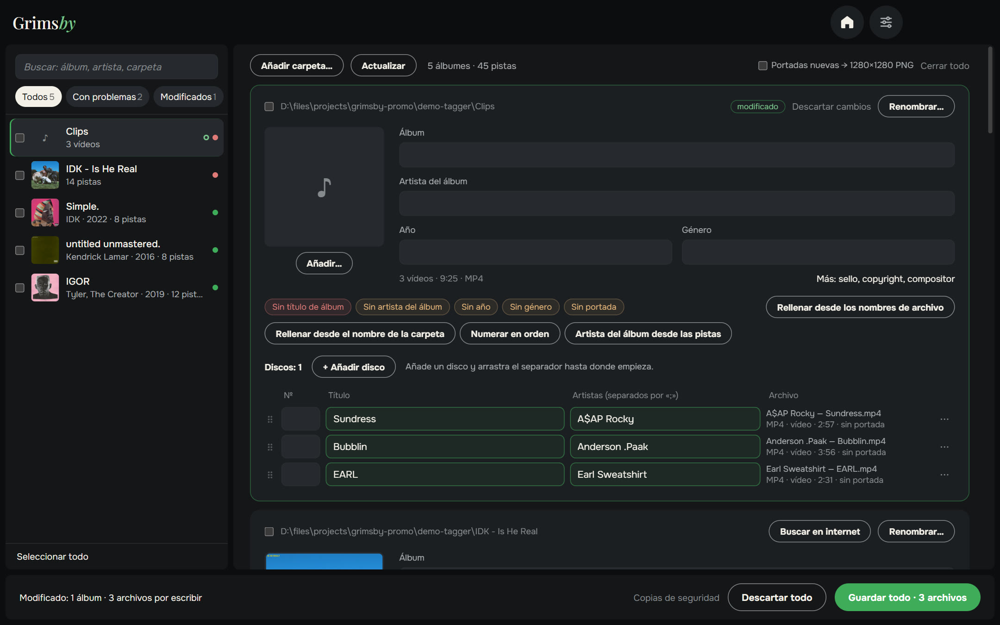
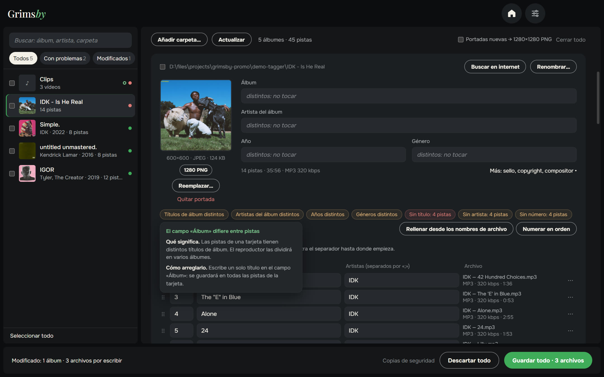
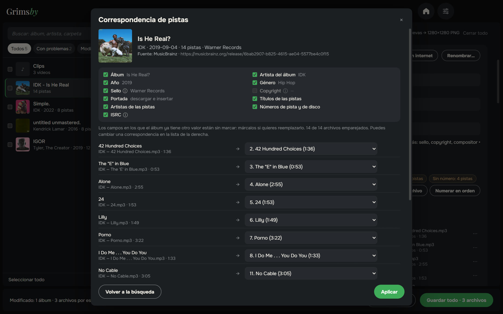
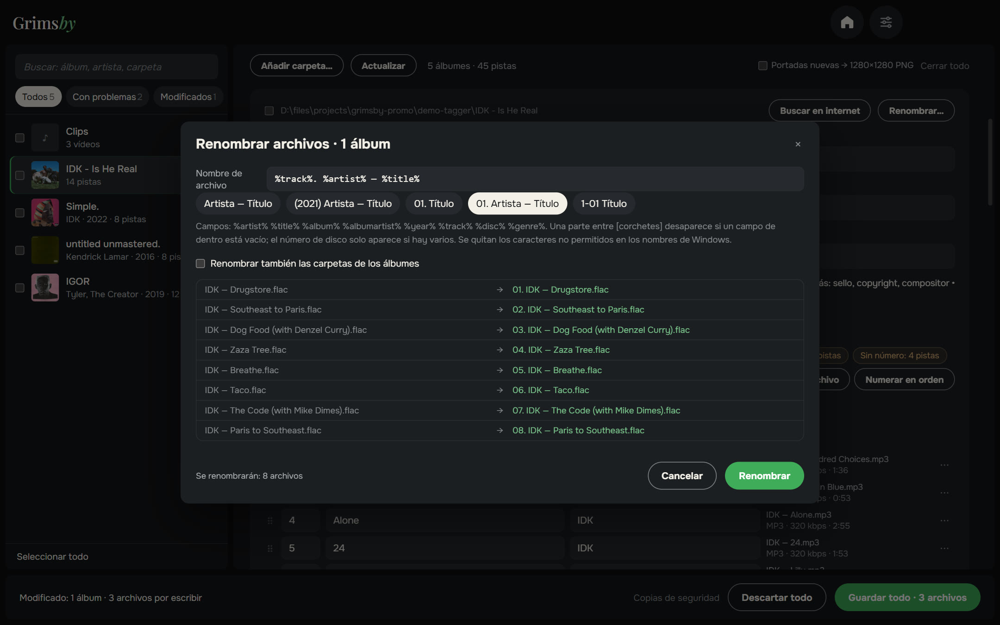
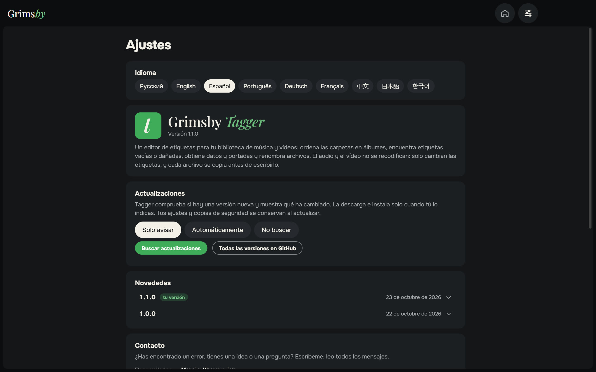
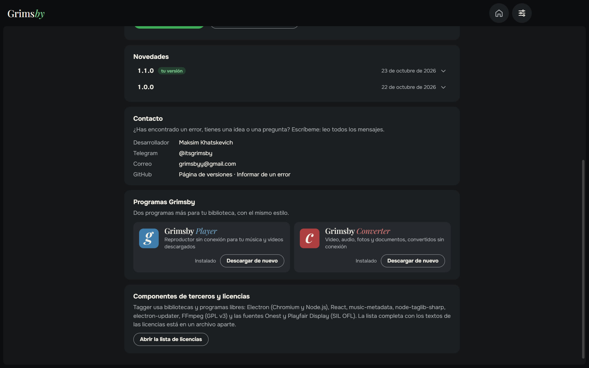

  <a href="README.md">English</a> ·
  <a href="README.ru.md">Русский</a> ·
  <b>Español</b> ·
  <a href="README.pt.md">Português</a> ·
  <a href="README.de.md">Deutsch</a> ·
  <a href="README.fr.md">Français</a> ·
  <a href="README.zh.md">中文</a> ·
  <a href="README.ja.md">日本語</a> ·
  <a href="README.ko.md">한국어</a>

  

  <b>Pon en orden las etiquetas de toda tu biblioteca musical, álbum por álbum y no archivo por archivo.</b> 
  Todos los problemas a la vista, arreglados en un par de clics y guardados con un botón. Ahora también para videos.

  
  
  
  
  

  <a href="https://github.com/maksimkhatskevich/grimsby-tagger/releases/latest"><b>⬇ Descargar para Windows</b></a>
  &nbsp;·&nbsp;
  <a href="#funciones">Funciones</a>
  &nbsp;·&nbsp;
  <a href="#tus-archivos-están-a-salvo">Seguridad</a>
  &nbsp;·&nbsp;
  <a href="#contacto">Contacto</a>

---

## Por qué Grimsby Tagger

Las etiquetas son lo que hace que una colección se vea bien en un reproductor: el álbum, el año, el artista, los números de pista y la portada correctos. La música descargada casi nunca llega perfecta: a un álbum le falta el año, a otro la portada, otro tiene caracteres rotos. Los editores clásicos muestran una tabla de miles de archivos que hay que corregir fila por fila.

**Grimsby Tagger piensa en álbumes.** Indica una carpeta de cualquier profundidad: agrupa los archivos en álbumes, muestra cada uno como una tarjeta con su portada y resalta lo que está mal. Edita lo que quieras y pulsa **Guardar todo** (Ctrl+S).

---

## Funciones

### 💿 Los álbumes se ordenan solos

Un álbum es una carpeta más la etiqueta «Álbum». Varios álbumes en una carpeta se separan; las subcarpetas CD1/CD2 se unen en un solo álbum; los archivos sin etiquetas se suman al álbum de su carpeta. La edición normal y la deluxe de una misma carpeta forman una sola tarjeta. ¿Una pista en el álbum equivocado? Arrástrala al correcto: al guardar recibe las etiquetas y la portada de ese álbum y se mueve a su carpeta.

### 🎬 También videos

Videoclips, conciertos y otros videos se editan igual que la música, por lotes, en las propias tarjetas: MP4, M4V, WMV, MKV, WebM y MOV. El video nunca se recodifica: solo cambian las etiquetas y, si el formato lo permite, la portada.

### 🩺 Problemas a la vista

Archivos ilegibles, campos vacíos, valores distintos dentro de un álbum, números repetidos, portadas que faltan o son pequeñas, texto roto por codificaciones antiguas, etiquetas dañadas. Pasa el cursor sobre el aviso para ver qué falla y cómo arreglarlo; **Reescribir etiquetas** repara las dañadas. El filtro **«Con problemas»** muestra solo los álbumes que lo necesitan.

### 🪄 Arreglos en un clic

Solo rellenan lo vacío, nunca sobrescriben tus datos:

- títulos, artistas y números a partir de nombres como `01. Artista — Título`;
- álbum, artista y año a partir del nombre de carpeta `Artista — Álbum (2021)`;
- numeración en orden, artista del álbum a partir de las pistas;
- corrección de la codificación, incrustar `cover.jpg` de la carpeta.

### 🌐 Busca el álbum en internet

Pega un enlace al álbum de un servicio de música o escribe `Artista — Álbum`. Grimsby encuentra la edición en bases de datos musicales abiertas, **empareja las pistas con tus archivos** por título, duración y número, y te deja elegir qué campos tomar. Los campos que ya tienen otro valor no se tocan por defecto.

### ✏️ Renombrar con una plantilla

Plantillas como `%artist% — %title%` o `[%disc%-]%track% %title%`, también para las carpetas de los álbumes si quieres. Vista previa, control de duplicados y **Deshacer el cambio de nombre** si te arrepientes.

### 📦 Edición por lotes y más

- Marca varios álbumes → artista del álbum, año, género o sello para todos a la vez; únelos en un solo álbum.
- Campos extra: sello, copyright, compositor, comentario, ISRC, letra.
- Portadas: reemplazar, arrastrar una imagen, verla a tamaño completo, recortarla en cuadrado, llevarla al estándar PNG 1280×1280 o descargarla de la edición encontrada.

### ⚙️ Ajustes en una sola página

Idioma, actualizaciones (solo avisar, automáticas o no comprobar), novedades, contacto y las otras apps de Grimsby, todo en una página. La ventana recuerda su tamaño y posición.

🌍 **9 idiomas:** inglés, ruso, español, portugués, alemán, francés, chino, japonés y coreano; se cambian en Ajustes al instante.

---

## Tus archivos están a salvo

- Solo se escriben etiquetas: **el audio y el video nunca se recodifican**.
- Antes de editar, cada archivo se copia a una carpeta de respaldo (se guarda 14 días).
- Después de escribir, el archivo se vuelve a leer. Si no se abre o su duración cambió, se restaura el original automáticamente.

Música: MP3, FLAC, M4A (AAC/ALAC), OGG, Opus, WAV, AIFF, APE, WavPack, WMA y DSF. Video: MP4, M4V, WMV, MKV, WebM y MOV.

---

## Descargar e instalar

1. Abre la página de la **[última versión](https://github.com/maksimkhatskevich/grimsby-tagger/releases/latest)** y descarga el instalador `.exe`.
2. Ejecútalo. Windows puede mostrar una ventana azul «Windows protegió su PC»: es un aviso normal para programas sin certificado de firma de pago. Pulsa **Más información → Ejecutar de todas formas**.
   El instalador se ha analizado en VirusTotal: [ninguno de 67 antivirus detecta nada](https://www.virustotal.com/gui/file/e4dfabdb0c5f60a9fc7c6c42132a6e3492d6ef2414fcf21a93ebd759987a35e0) (versión 1.1.0).
3. Pulsa **Añadir carpeta…** o arrastra tu carpeta de música a la ventana.

**Requisitos:** Windows 10 u 11 (64 bits). Internet solo hace falta para buscar álbumes.

---

## Privacidad

Grimsby Tagger funciona en tu ordenador. Sin cuentas, sin anuncios, sin analíticas. Solo se conecta cuando buscas un álbum y para comprobar actualizaciones.

---

## Las apps de Grimsby

<table>
  <tr>
    <td align="center" width="33%"><a href="https://github.com/maksimkhatskevich/grimsby-releases/blob/main/README.es.md"> <b>Grimsby Player</b></a> Reproductor sin conexión para tu música y videos descargados</td>
    <td align="center" width="33%"><a href="https://github.com/maksimkhatskevich/grimsby-converter/blob/main/README.es.md"> <b>Grimsby Converter</b></a> Video, audio, fotos y documentos, convertidos sin conexión</td>
    <td align="center" width="33%"> <b>Grimsby Tagger</b> </td>
  </tr>
</table>

---

## Contacto

¿Encontraste un error, tienes una idea o solo quieres dar las gracias? Escríbeme:

- ✉️ correo: **[grimsbyy@gmail.com](mailto:grimsbyy@gmail.com)**
- 🐞 errores e ideas: [Issues](https://github.com/maksimkhatskevich/grimsby-tagger/issues)
- 📣 Telegram: [@itsgrimsby](https://t.me/itsgrimsby) (en ruso)

---

## Licencias

Grimsby Tagger usa componentes de código abierto, entre ellos Electron, React, music-metadata y TagLib#. La lista completa con los textos de las licencias está en `THIRD_PARTY_NOTICES.txt`, en la carpeta del programa. Las portadas de las capturas pertenecen a sus titulares y se muestran como ejemplo de una biblioteca personal.

© 2026 Grimsby

