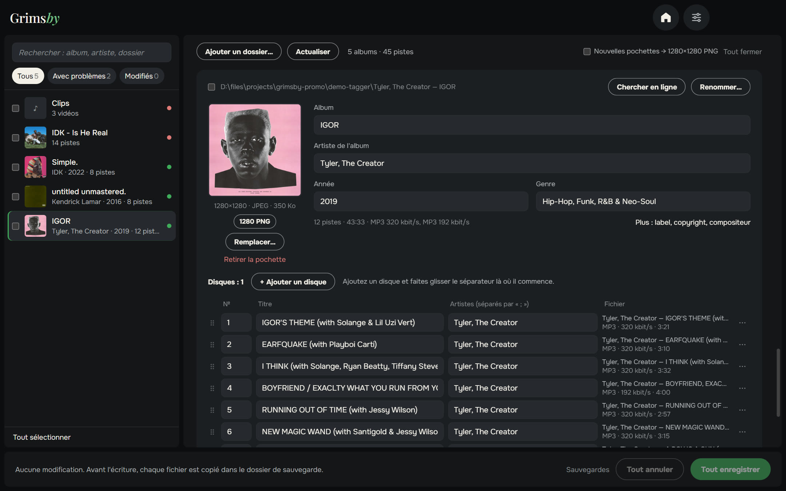
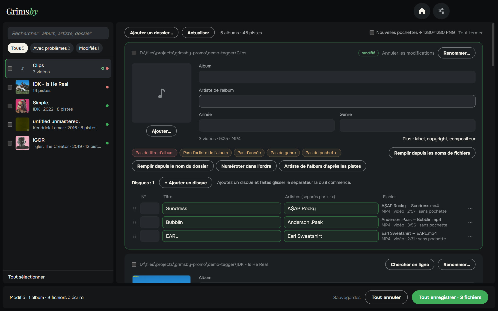
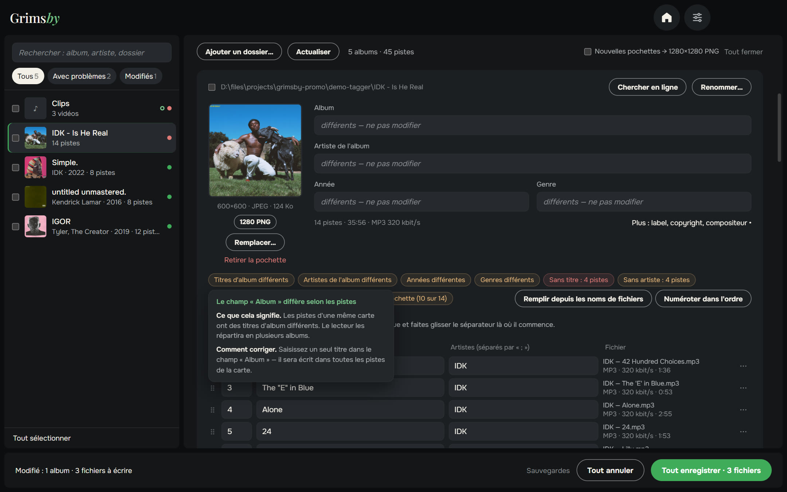
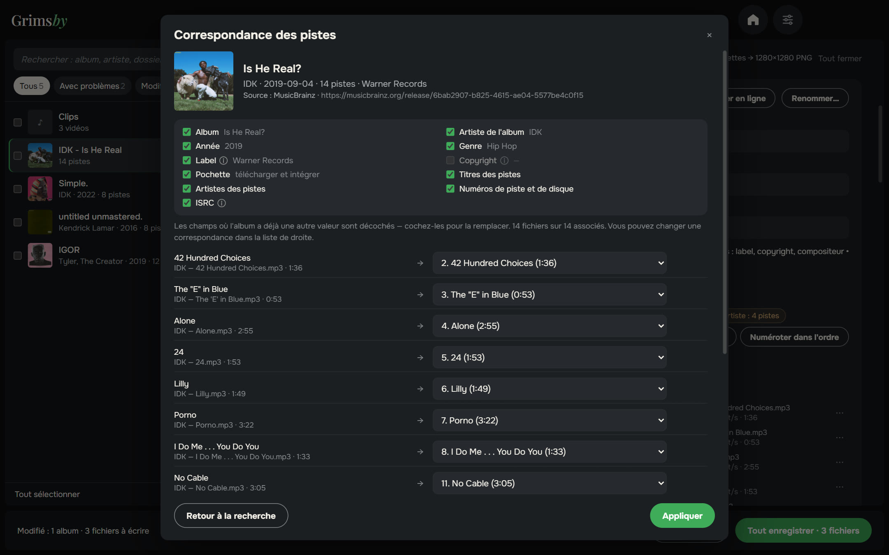
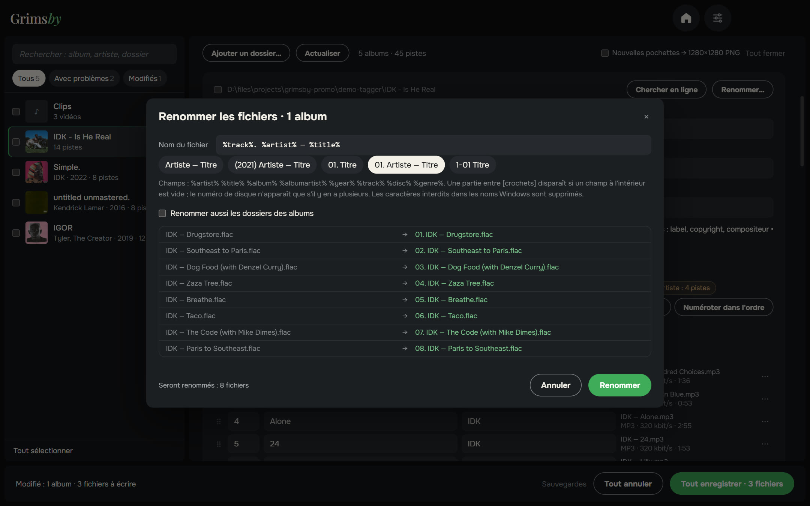
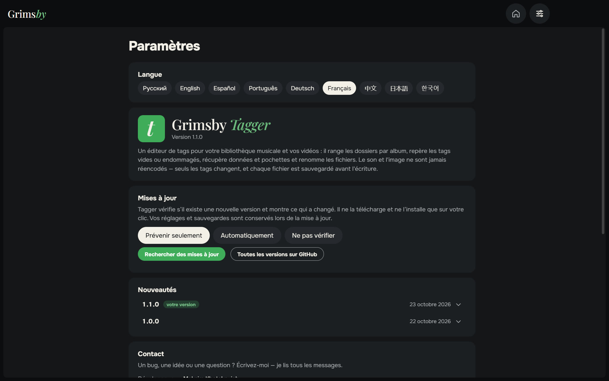
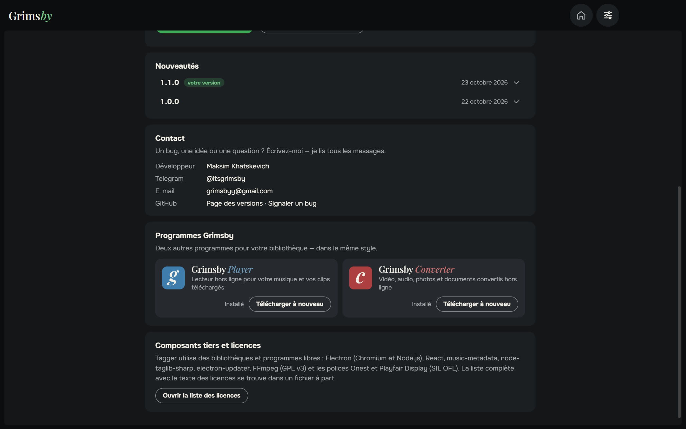

  <a href="README.md">English</a> ·
  <a href="README.ru.md">Русский</a> ·
  <a href="README.es.md">Español</a> ·
  <a href="README.pt.md">Português</a> ·
  <a href="README.de.md">Deutsch</a> ·
  <b>Français</b> ·
  <a href="README.zh.md">中文</a> ·
  <a href="README.ja.md">日本語</a> ·
  <a href="README.ko.md">한국어</a>

  

  <b>Mettez de l’ordre dans les tags de toute votre bibliothèque — album par album, pas fichier par fichier.</b> 
  Tous les problèmes d’un coup d’œil, corrigés en deux clics et enregistrés d’un seul bouton. Désormais aussi pour les vidéos.

  
  
  
  
  

  <a href="https://github.com/maksimkhatskevich/grimsby-tagger/releases/latest"><b>⬇ Télécharger pour Windows</b></a>
  &nbsp;·&nbsp;
  <a href="#fonctionnalités">Fonctionnalités</a>
  &nbsp;·&nbsp;
  <a href="#vos-fichiers-sont-en-sécurité">Sécurité</a>
  &nbsp;·&nbsp;
  <a href="#contact">Contact</a>

---

## Pourquoi Grimsby Tagger

Les tags font qu’une collection est belle dans un lecteur : le bon album, l’année, l’artiste, les numéros de piste et la pochette. La musique téléchargée arrive rarement parfaite — un album sans année, un autre sans pochette, un troisième avec des caractères cassés. Les éditeurs classiques affichent un tableau de milliers de fichiers à corriger ligne par ligne.

**Grimsby Tagger pense en albums.** Indiquez un dossier de n’importe quelle profondeur : il regroupe les fichiers en albums, affiche chacun sous forme de carte avec sa pochette et signale ce qui cloche. Modifiez ce que vous voulez, puis **Tout enregistrer** (Ctrl+S).

---

## Fonctionnalités

### 💿 Les albums se rangent tout seuls

Un album, c’est un dossier plus le tag « Album ». Plusieurs albums dans un dossier sont séparés ; les sous-dossiers CD1/CD2 sont réunis ; les fichiers sans tags rejoignent l’album de leur dossier. Les éditions standard et deluxe d’un même dossier forment une seule carte. Une piste dans le mauvais album ? Glissez-la dans le bon : à l’enregistrement, elle prend ses tags et sa pochette et rejoint son dossier.

### 🎬 Les vidéos aussi

Clips, concerts et autres vidéos se modifient comme la musique, par lots, directement dans les cartes : MP4, M4V, WMV, MKV, WebM et MOV. La vidéo n’est jamais réencodée — seuls les tags et, quand le format le permet, la pochette changent.

### 🩺 Problèmes bien visibles

Fichiers illisibles, champs vides, valeurs disparates dans un album, numéros en double, pochette absente ou trop petite, texte cassé par d’anciens encodages, tags endommagés. Survolez l’alerte pour savoir ce qui ne va pas et comment le corriger ; **Réécrire les tags** répare ceux qui sont abîmés. Le filtre **« Avec problèmes »** n’affiche que les albums à revoir.

### 🪄 Corrections en un clic

Elles ne remplissent que le vide, sans jamais écraser vos données :

- titres, artistes et numéros à partir de noms comme `01. Artiste — Titre` ;
- album, artiste et année à partir du nom de dossier `Artiste — Album (2021)` ;
- numérotation dans l’ordre, artiste de l’album d’après les pistes ;
- correction de l’encodage, intégration de `cover.jpg` du dossier.

### 🌐 Trouver l’album en ligne

Collez le lien d’un album sur un service de musique — ou tapez simplement `Artiste — Album`. Grimsby trouve la sortie dans des bases musicales ouvertes, **associe les titres à vos fichiers** par nom, durée et numéro, et vous laisse choisir les champs à reprendre. Les champs qui ont déjà une autre valeur restent intacts par défaut.

### ✏️ Renommer selon un modèle

Des modèles comme `%artist% — %title%` ou `[%disc%-]%track% %title%`, aussi pour les dossiers d’albums si vous voulez. Aperçu, contrôle des doublons — et **Annuler le renommage** si vous changez d’avis.

### 📦 Modification par lots et plus

- Cochez plusieurs albums → artiste de l’album, année, genre ou label pour tous d’un coup ; fusionnez-les en un seul album.
- Champs supplémentaires : label, copyright, compositeur, commentaire, ISRC, paroles.
- Pochettes : remplacer, glisser une image, voir en grand, recadrer en carré, passer au standard PNG 1280×1280 ou télécharger depuis la sortie trouvée.

### ⚙️ Réglages sur une seule page

Langue, mises à jour (prévenir seulement, automatiquement ou ne pas vérifier), nouveautés, contact et les autres applis Grimsby — tout sur une page. La fenêtre retient sa taille et sa position.

🌍 **9 langues :** anglais, russe, espagnol, portugais, allemand, français, chinois, japonais et coréen — à changer dans les Réglages, effet immédiat.

---

## Vos fichiers sont en sécurité

- Seuls les tags sont écrits — **l’audio et la vidéo ne sont jamais réencodés**.
- Avant modification, chaque fichier est copié dans un dossier de sauvegarde (conservé 14 jours).
- Après l’écriture, le fichier est relu. S’il ne s’ouvre pas ou si sa durée a changé, l’original est restauré automatiquement.

Musique : MP3, FLAC, M4A (AAC/ALAC), OGG, Opus, WAV, AIFF, APE, WavPack, WMA et DSF. Vidéo : MP4, M4V, WMV, MKV, WebM et MOV.

---

## Télécharger et installer

1. Ouvrez la page de la **[dernière version](https://github.com/maksimkhatskevich/grimsby-tagger/releases/latest)** et téléchargez l’installeur `.exe`.
2. Lancez-le. Windows peut afficher une fenêtre bleue « Windows a protégé votre ordinateur » : c’est un avertissement normal pour les logiciels sans certificat de signature payant. Cliquez sur **Informations complémentaires → Exécuter quand même**.
   L’installeur a été vérifié sur VirusTotal : [aucun des 67 antivirus ne détecte quoi que ce soit](https://www.virustotal.com/gui/file/e4dfabdb0c5f60a9fc7c6c42132a6e3492d6ef2414fcf21a93ebd759987a35e0) (version 1.1.0).
3. Cliquez sur **Ajouter un dossier…** ou glissez votre dossier de musique dans la fenêtre.

**Configuration requise :** Windows 10 ou 11 (64 bits). Internet ne sert qu’à rechercher des albums.

---

## Confidentialité

Grimsby Tagger fonctionne sur votre ordinateur. Pas de compte, pas de pub, pas de statistiques. Il ne se connecte que lorsque vous cherchez un album et pour vérifier les mises à jour.

---

## Les applis Grimsby

<table>
  <tr>
    <td align="center" width="33%"><a href="https://github.com/maksimkhatskevich/grimsby-releases/blob/main/README.fr.md"> <b>Grimsby Player</b></a> Lecteur hors ligne pour votre musique et vos clips téléchargés</td>
    <td align="center" width="33%"><a href="https://github.com/maksimkhatskevich/grimsby-converter/blob/main/README.fr.md"> <b>Grimsby Converter</b></a> Vidéo, audio, photos et documents convertis hors ligne</td>
    <td align="center" width="33%"> <b>Grimsby Tagger</b> </td>
  </tr>
</table>

---

## Contact

Un bug, une idée ou juste envie de dire merci ? Écrivez-moi :

- ✉️ e-mail: **[grimsbyy@gmail.com](mailto:grimsbyy@gmail.com)**
- 🐞 bugs et idées: [Issues](https://github.com/maksimkhatskevich/grimsby-tagger/issues)
- 📣 Telegram : [@itsgrimsby](https://t.me/itsgrimsby) (en russe)

---

## Licences

Grimsby Tagger utilise des composants open source, dont Electron, React, music-metadata et TagLib#. La liste complète avec les textes des licences se trouve dans `THIRD_PARTY_NOTICES.txt`, dans le dossier du programme. Les pochettes des captures appartiennent à leurs ayants droit et illustrent une bibliothèque personnelle.

© 2026 Grimsby

