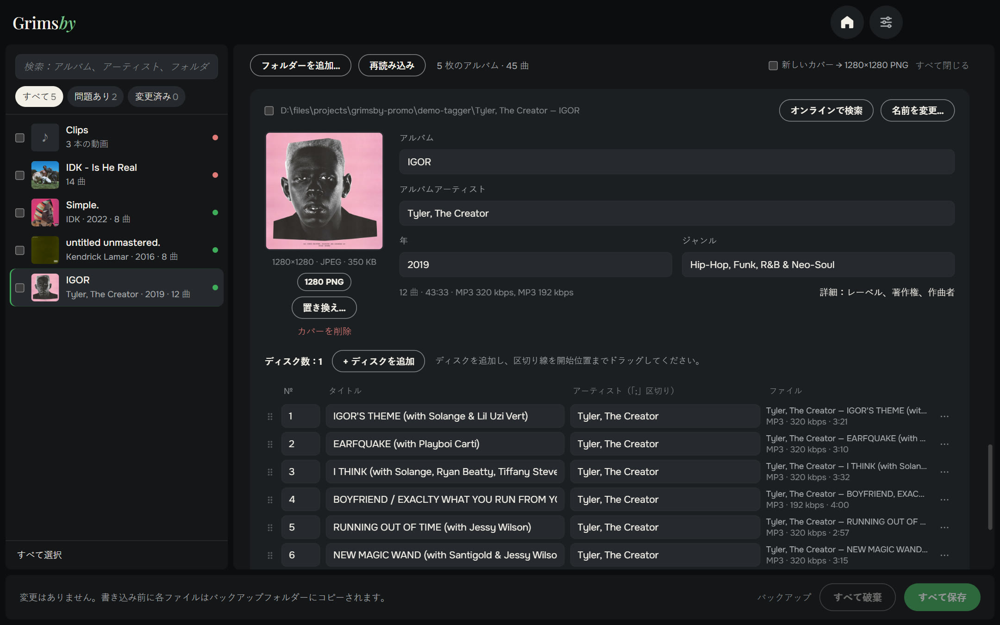
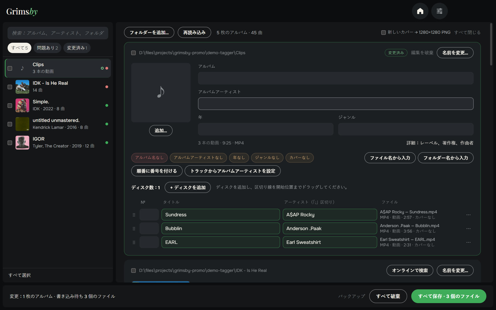
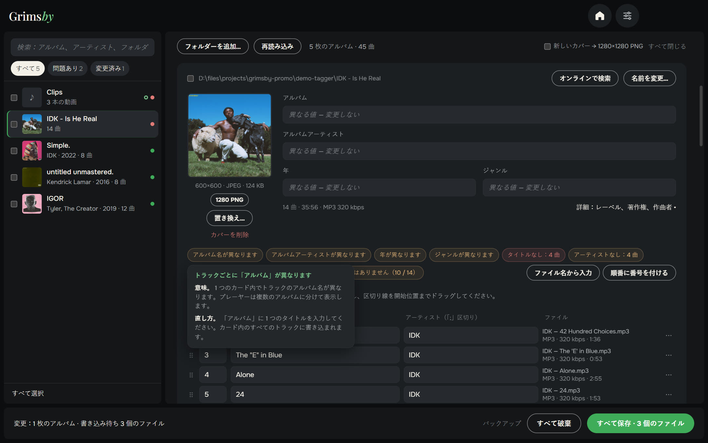
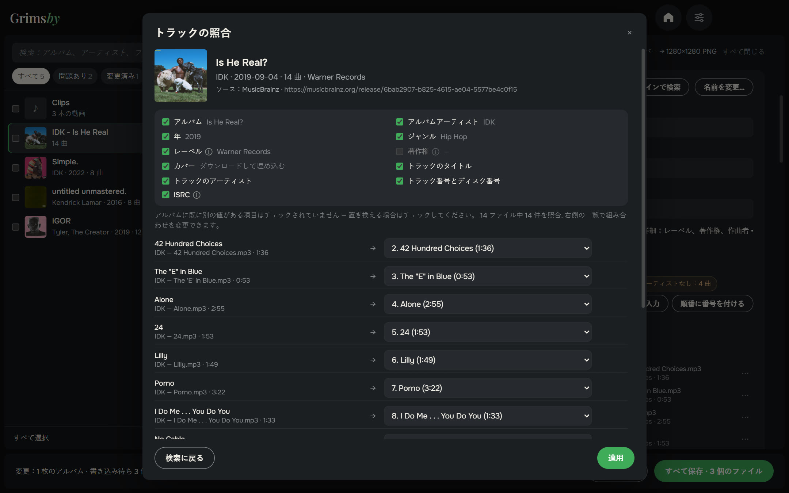
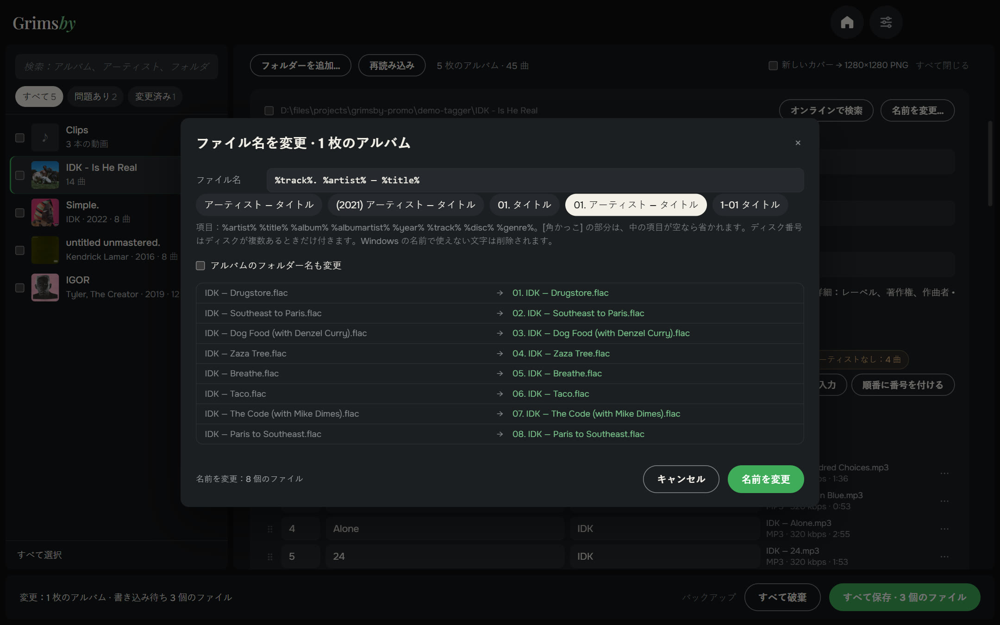
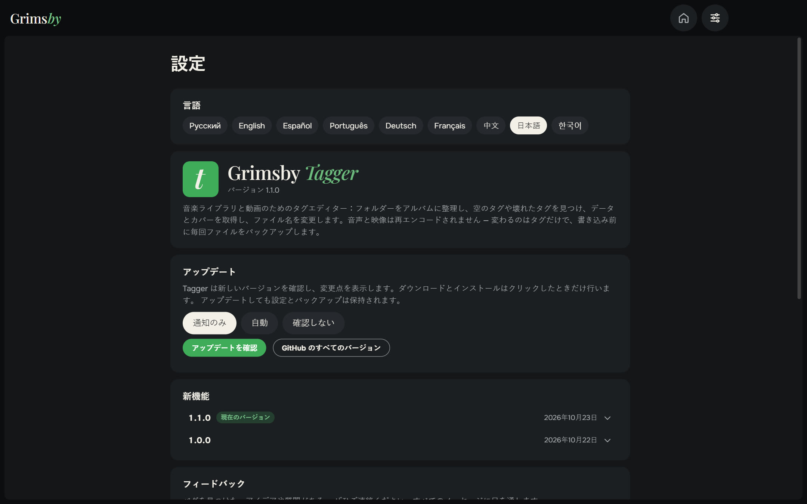
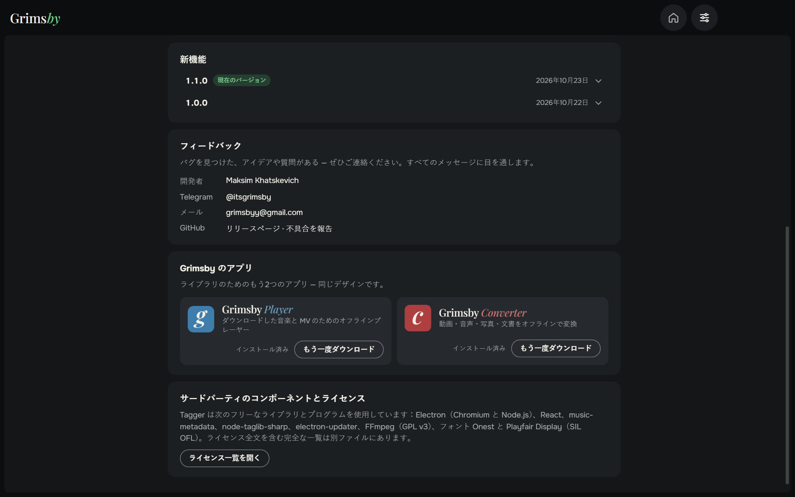

  <a href="README.md">English</a> ·
  <a href="README.ru.md">Русский</a> ·
  <a href="README.es.md">Español</a> ·
  <a href="README.pt.md">Português</a> ·
  <a href="README.de.md">Deutsch</a> ·
  <a href="README.fr.md">Français</a> ·
  <a href="README.zh.md">中文</a> ·
  <b>日本語</b> ·
  <a href="README.ko.md">한국어</a>

  

  <b>音楽ライブラリ全体のタグを、ファイル単位ではなくアルバム単位で整えましょう。</b> 
  問題はひと目でわかり、数クリックで修正、ボタンひとつで保存。動画にも対応しました。

  
  
  
  
  

  <a href="https://github.com/maksimkhatskevich/grimsby-tagger/releases/latest"><b>⬇ Windows 版をダウンロード</b></a>
  &nbsp;·&nbsp;
  <a href="#機能">機能</a>
  &nbsp;·&nbsp;
  <a href="#ファイルは安全です">安全性</a>
  &nbsp;·&nbsp;
  <a href="#お問い合わせ">お問い合わせ</a>

---

## Grimsby Tagger を選ぶ理由

タグは、プレーヤーでコレクションをきれいに見せるためのもの。正しいアルバム名、年、アーティスト、曲番号、カバー。ダウンロードした音楽は完璧とは限りません。年がないアルバム、カバーのないアルバム、文字化けしたアルバム。従来のタグエディターは何千ものファイルを表で見せるので、1 行ずつ直すことになります。

**Grimsby Tagger はアルバム単位で考えます。** どんな階層のフォルダーでも指定すれば、ファイルをアルバムにまとめ、カバー付きのカードで表示し、問題のある箇所を知らせます。好きなように編集して **すべて保存**（Ctrl+S）。

---

## 機能

### 💿 アルバムを自動で整理

アルバム＝フォルダー＋「アルバム」タグ。ひとつのフォルダーに複数のアルバムがあれば分け、CD1/CD2 のサブフォルダーはひとつにまとめ、タグのないファイルはフォルダーのアルバムに加えます。同じフォルダーの通常盤とデラックス盤はひとつのカードに。曲が別のアルバムに紛れていたら、正しいアルバムへドラッグ。保存すると、そのアルバムのタグとカバーが付き、フォルダーも移動します。

### 🎬 動画にも対応

MV、ライブ映像などの動画も、音楽と同じようにカードの中でまとめて編集できます：MP4、M4V、WMV、MKV、WebM、MOV。動画は再エンコードせず、タグと（形式が対応していれば）カバーだけを変更します。

### 🩺 問題がひと目でわかる

読めないファイル、空欄、アルバム内で不揃いな値、重複した曲番号、カバーがない・小さい、古い文字コードによる文字化け、壊れたタグ。問題のバッジにカーソルを合わせると、何が問題でどう直せばよいかを表示。**タグを書き直す** で壊れたタグを修復します。**「問題あり」** フィルターで対応が必要なアルバムだけを表示。

### 🪄 ワンクリックで修正

空欄だけを埋め、入力済みのデータは上書きしません：

- `01. アーティスト — タイトル` のようなファイル名から、曲名・アーティスト・番号を入力
- `アーティスト — アルバム (2021)` のようなフォルダー名から、アルバム・アーティスト・年を入力
- 曲番号を順番どおりに振り、曲からアルバムアーティストを入力
- 文字化けの修正、フォルダー内の `cover.jpg` を埋め込み

### 🌐 アルバムをネットで探す

音楽サービスのアルバムのリンクを貼るか、`アーティスト — アルバム` と入力するだけ。Grimsby がオープンな音楽データベースからリリースを探し、曲名・長さ・番号で **曲をあなたのファイルに対応付け**、どの項目を使うか選べます。すでに別の値が入っている項目は、初期設定では変更しません。

### ✏️ テンプレートで名前を変更

`%artist% — %title%` や `[%disc%-]%track% %title%` のようなテンプレートで、必要ならアルバムのフォルダー名も変更。プレビューと重複チェック付きで、気が変わったら **名前の変更を元に戻す** こともできます。

### 📦 一括編集など

- 複数のアルバムにチェック → アルバムアーティスト、年、ジャンル、レーベルを一度に設定。ひとつのアルバムに統合も。
- 追加項目：レーベル、著作権、作曲者、コメント、ISRC、歌詞。
- カバー：差し替え、画像のドラッグ、原寸表示、正方形にトリミング、1280×1280 PNG に統一、見つかったリリースからダウンロード。

### ⚙️ 設定はひとつのページに

言語、アップデート（通知のみ・自動・確認しない）、更新内容、お問い合わせ、ほかの Grimsby アプリをひとつのページに。ウィンドウのサイズと位置も記憶します。

🌍 **9 言語：** 英語、ロシア語、スペイン語、ポルトガル語、ドイツ語、フランス語、中国語、日本語、韓国語。設定で切り替えるとすぐに反映されます。

---

## ファイルは安全です

- 書き込むのはタグだけ。**音声も動画も再エンコードしません**。
- 編集前に、すべてのファイルをバックアップフォルダーにコピー（14 日間保存）。
- 書き込み後にファイルを読み直し、開けない・長さが変わった場合は自動で元に戻します。

音楽：MP3、FLAC、M4A（AAC/ALAC）、OGG、Opus、WAV、AIFF、APE、WavPack、WMA、DSF。動画：MP4、M4V、WMV、MKV、WebM、MOV。

---

## ダウンロードとインストール

1. **[最新バージョン](https://github.com/maksimkhatskevich/grimsby-tagger/releases/latest)** のページを開き、インストーラー `.exe` をダウンロードします。
2. 実行します。Windows に青い「Windows によって PC が保護されました」画面が出ることがありますが、有料の署名証明書がないアプリでは普通の警告です。**詳細情報 → 実行** をクリックしてください。
   インストーラーは VirusTotal で確認済みです：[67 のウイルス対策エンジンすべてで検出なし](https://www.virustotal.com/gui/file/e4dfabdb0c5f60a9fc7c6c42132a6e3492d6ef2414fcf21a93ebd759987a35e0)（バージョン 1.1.0）。
3. **フォルダーを追加…** をクリックするか、音楽フォルダーを画面にドラッグします。

**動作環境：** Windows 10 / 11（64 ビット）。 インターネットはアルバムを探すときだけ必要です。

---

## プライバシー

Grimsby Tagger はあなたのパソコンの中で動きます。アカウントも広告も分析もありません。インターネットに接続するのは、アルバムを探すときとアップデートの確認時だけです。

---

## Grimsby のアプリ

<table>
  <tr>
    <td align="center" width="33%"><a href="https://github.com/maksimkhatskevich/grimsby-releases/blob/main/README.ja.md"> <b>Grimsby Player</b></a> ダウンロードした音楽と MV のためのオフラインプレーヤー</td>
    <td align="center" width="33%"><a href="https://github.com/maksimkhatskevich/grimsby-converter/blob/main/README.ja.md"> <b>Grimsby Converter</b></a> 動画・音声・写真・文書をオフラインで変換</td>
    <td align="center" width="33%"> <b>Grimsby Tagger</b> </td>
  </tr>
</table>

---

## お問い合わせ

不具合を見つけた、アイデアがある、またはお礼を伝えたい？ご連絡ください：

- ✉️ メール: **[grimsbyy@gmail.com](mailto:grimsbyy@gmail.com)**
- 🐞 不具合とアイデア: [Issues](https://github.com/maksimkhatskevich/grimsby-tagger/issues)
- 📣 Telegram：[@itsgrimsby](https://t.me/itsgrimsby)（ロシア語）

---

## ライセンス

Grimsby Tagger は Electron、React、music-metadata、TagLib# などのオープンソースコンポーネントを使用しています。ライセンス本文を含む一覧は、プログラムフォルダーの `THIRD_PARTY_NOTICES.txt` にあります。スクリーンショットのアルバムカバーは各権利者に帰属し、個人のライブラリの例として表示しています。

© 2026 Grimsby

