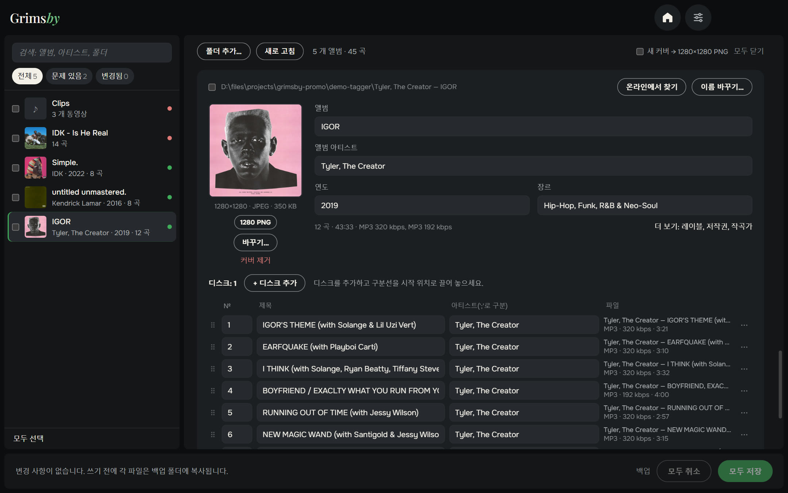
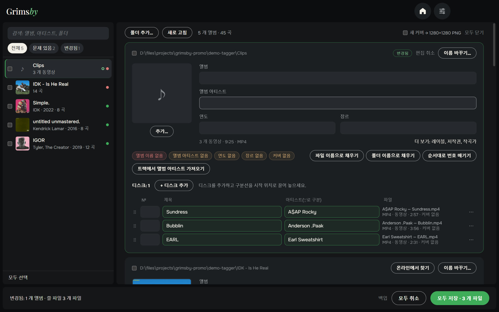
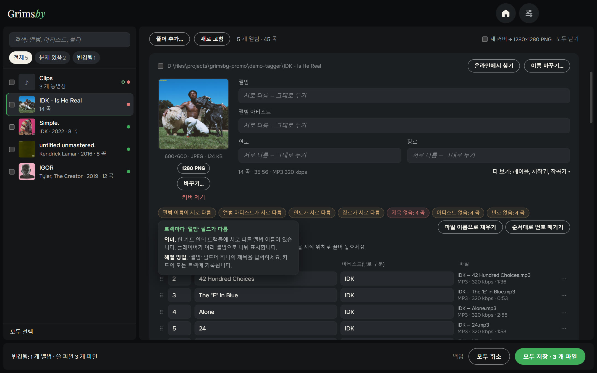
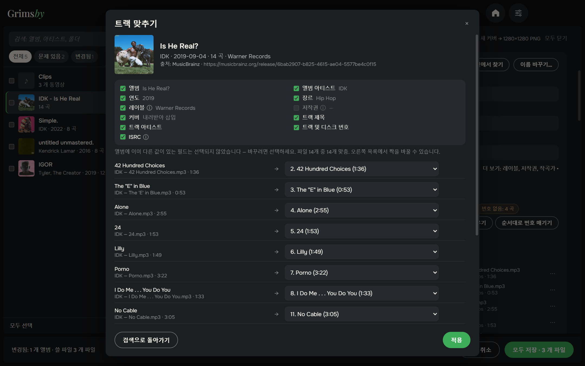
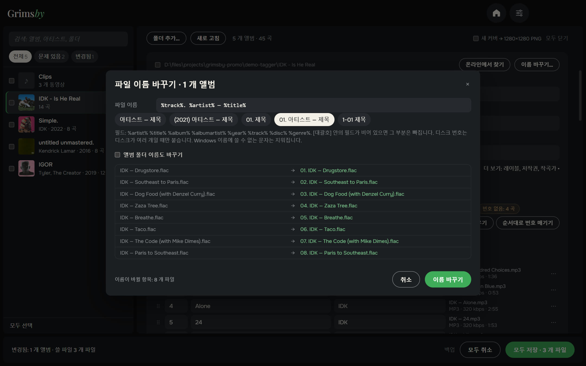
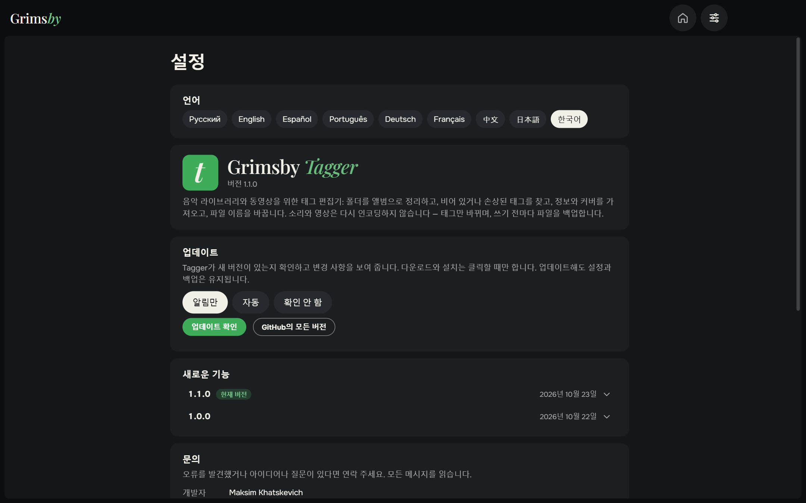
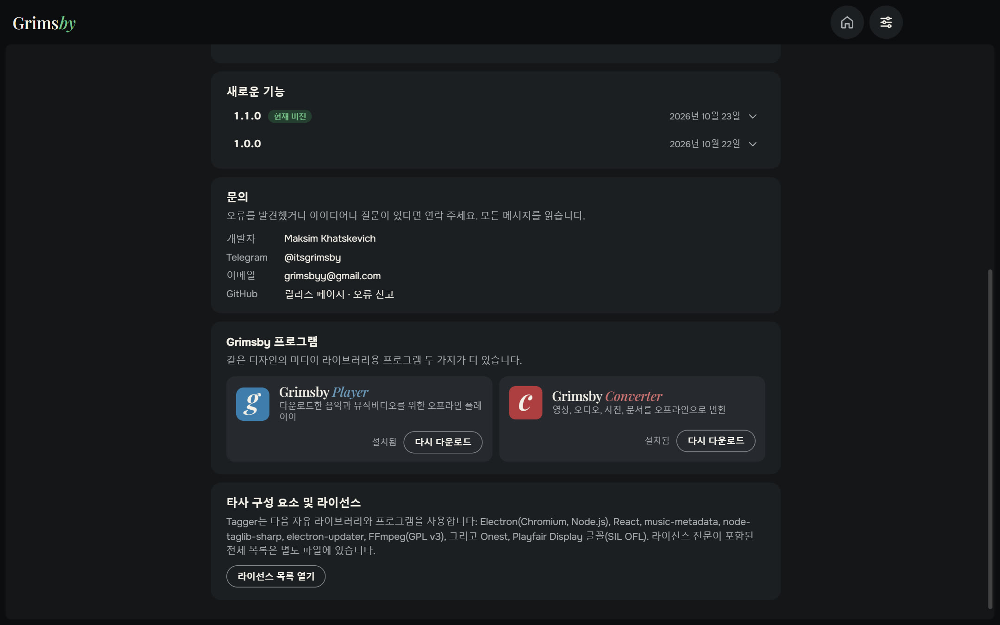

  <a href="README.md">English</a> ·
  <a href="README.ru.md">Русский</a> ·
  <a href="README.es.md">Español</a> ·
  <a href="README.pt.md">Português</a> ·
  <a href="README.de.md">Deutsch</a> ·
  <a href="README.fr.md">Français</a> ·
  <a href="README.zh.md">中文</a> ·
  <a href="README.ja.md">日本語</a> ·
  <b>한국어</b>

  

  <b>음악 라이브러리 전체의 태그를 파일 하나하나가 아니라 앨범 단위로 정리하세요.</b> 
  모든 문제가 한눈에 보이고, 클릭 몇 번으로 고치고, 버튼 하나로 저장합니다. 이제 영상도 됩니다.

  
  
  
  
  

  <a href="https://github.com/maksimkhatskevich/grimsby-tagger/releases/latest"><b>⬇ Windows용 다운로드</b></a>
  &nbsp;·&nbsp;
  <a href="#기능">기능</a>
  &nbsp;·&nbsp;
  <a href="#파일은-안전합니다">안전</a>
  &nbsp;·&nbsp;
  <a href="#문의">문의</a>

---

## 왜 Grimsby Tagger인가

태그는 컬렉션을 플레이어에서 보기 좋게 만들어 줍니다. 올바른 앨범, 연도, 아티스트, 트랙 번호, 커버까지. 하지만 다운로드한 음악이 완벽한 경우는 드뭅니다. 어떤 앨범은 연도가 없고, 어떤 앨범은 커버가 없고, 어떤 앨범은 글자가 깨져 있죠. 기존 태그 편집기는 수천 개 파일을 표로 보여 줘서 한 줄씩 고쳐야 합니다.

**Grimsby Tagger는 앨범 단위로 생각합니다.** 어느 깊이의 폴더든 지정하면 파일을 앨범으로 묶고, 커버가 있는 카드로 보여 주며, 문제가 있는 곳을 표시합니다. 원하는 대로 고친 뒤 **모두 저장**(Ctrl+S)을 누르세요.

---

## 기능

### 💿 앨범이 알아서 정리

앨범은 폴더와 "앨범" 태그로 정해집니다. 한 폴더의 여러 앨범은 나누고, CD1/CD2 하위 폴더는 하나로 합치며, 태그 없는 파일은 해당 폴더의 앨범에 붙입니다. 같은 폴더의 일반판과 디럭스판은 카드 하나로 보여 줍니다. 트랙이 다른 앨범에 들어갔나요? 올바른 앨범으로 끌어다 놓으면, 저장할 때 그 앨범의 태그와 커버를 받고 폴더도 옮겨집니다.

### 🎬 영상도 함께

뮤직비디오, 공연 영상 등도 음악처럼 카드에서 한꺼번에 편집합니다: MP4, M4V, WMV, MKV, WebM, MOV. 영상은 다시 인코딩하지 않고, 태그와 (형식이 지원하면) 커버만 바뀝니다.

### 🩺 문제가 한눈에

읽을 수 없는 파일, 빈 칸, 앨범 안의 제각각인 값, 겹치는 번호, 없거나 작은 커버, 옛 인코딩 때문에 깨진 글자, 손상된 태그. 문제 배지에 마우스를 올리면 무엇이 문제이고 어떻게 고치는지 알려 줍니다. **태그 다시 쓰기**로 손상된 태그를 고칩니다. **"문제 있음"** 필터는 손봐야 할 앨범만 보여 줍니다.

### 🪄 클릭 한 번으로 수정

빈 곳만 채우고, 기존 데이터는 덮어쓰지 않습니다:

- `01. 아티스트 — 제목` 같은 파일 이름에서 제목, 아티스트, 번호를 채움
- `아티스트 — 앨범 (2021)` 같은 폴더 이름에서 앨범, 아티스트, 연도를 채움
- 순서대로 번호 매기기, 트랙에서 앨범 아티스트 채우기
- 깨진 글자 복구, 폴더의 `cover.jpg` 삽입

### 🌐 인터넷에서 앨범 찾기

음악 서비스의 앨범 링크를 붙여 넣거나 `아티스트 — 앨범`을 입력하세요. Grimsby가 공개 음악 데이터베이스에서 음반을 찾아 제목, 길이, 번호로 **트랙을 내 파일과 연결**하고, 가져올 항목을 고르게 해 줍니다. 앨범에 이미 다른 값이 있는 항목은 기본적으로 그대로 둡니다.

### ✏️ 템플릿으로 이름 바꾸기

`%artist% — %title%`나 `[%disc%-]%track% %title%` 같은 템플릿으로, 원하면 앨범 폴더 이름도 바꿉니다. 미리 보기와 중복 확인이 있고, 마음이 바뀌면 **이름 바꾸기 취소**도 됩니다.

### 📦 일괄 편집 등

- 여러 앨범을 체크 → 앨범 아티스트, 연도, 장르, 레이블을 한 번에 설정하고 하나의 앨범으로 합치기.
- 추가 항목: 레이블, 저작권, 작곡가, 메모, ISRC, 가사.
- 커버: 교체, 이미지 끌어다 놓기, 원본 크기로 보기, 정사각형으로 자르기, 1280×1280 PNG로 맞추기, 찾은 음반에서 내려받기.

### ⚙️ 설정은 한 페이지에

언어, 업데이트(알림만, 자동, 확인 안 함), 새 소식, 문의, 다른 Grimsby 앱까지 한 페이지에. 창 크기와 위치도 기억합니다.

🌍 **9개 언어:** 영어, 러시아어, 스페인어, 포르투갈어, 독일어, 프랑스어, 중국어, 일본어, 한국어 — 설정에서 바꾸면 바로 적용됩니다.

---

## 파일은 안전합니다

- 태그만 씁니다 — **오디오와 영상은 다시 인코딩하지 않습니다**.
- 편집 전에 모든 파일을 백업 폴더에 복사합니다(14일 보관).
- 쓴 뒤에는 파일을 다시 읽어, 열리지 않거나 길이가 바뀌면 원본을 자동으로 되돌립니다.

음악: MP3, FLAC, M4A(AAC/ALAC), OGG, Opus, WAV, AIFF, APE, WavPack, WMA, DSF. 영상: MP4, M4V, WMV, MKV, WebM, MOV.

---

## 다운로드 및 설치

1. **[최신 버전](https://github.com/maksimkhatskevich/grimsby-tagger/releases/latest)** 페이지를 열고 설치 프로그램 `.exe`를 다운로드하세요.
2. 실행하세요. Windows가 파란색 "Windows의 PC 보호" 창을 띄울 수 있는데, 유료 코드 서명 인증서가 없는 프로그램에 대한 일반적인 경고입니다. **추가 정보 → 실행**을 누르세요.
   설치 프로그램은 VirusTotal에서 검사했습니다: [백신 엔진 67개 모두 이상 없음](https://www.virustotal.com/gui/file/e4dfabdb0c5f60a9fc7c6c42132a6e3492d6ef2414fcf21a93ebd759987a35e0) (버전 1.1.0).
3. **폴더 추가…**를 누르거나 음악 폴더를 창에 끌어다 놓으세요.

**요구 사항:** Windows 10 또는 11(64비트). 인터넷은 앨범을 찾을 때만 필요합니다.

---

## 개인정보

Grimsby Tagger는 내 컴퓨터에서 동작합니다. 계정도, 광고도, 분석도 없습니다. 인터넷에는 직접 앨범을 찾을 때와 업데이트를 확인할 때만 연결합니다.

---

## Grimsby 앱

<table>
  <tr>
    <td align="center" width="33%"><a href="https://github.com/maksimkhatskevich/grimsby-releases/blob/main/README.ko.md"> <b>Grimsby Player</b></a> 다운로드한 음악과 뮤직비디오를 위한 오프라인 플레이어</td>
    <td align="center" width="33%"><a href="https://github.com/maksimkhatskevich/grimsby-converter/blob/main/README.ko.md"> <b>Grimsby Converter</b></a> 영상, 오디오, 사진, 문서를 오프라인으로 변환</td>
    <td align="center" width="33%"> <b>Grimsby Tagger</b> </td>
  </tr>
</table>

---

## 문의

버그를 찾았거나, 아이디어가 있거나, 그냥 고맙다고 말하고 싶다면 연락 주세요:

- ✉️ 이메일: **[grimsbyy@gmail.com](mailto:grimsbyy@gmail.com)**
- 🐞 버그와 아이디어: [Issues](https://github.com/maksimkhatskevich/grimsby-tagger/issues)
- 📣 Telegram: [@itsgrimsby](https://t.me/itsgrimsby) (러시아어)

---

## 라이선스

Grimsby Tagger는 Electron, React, music-metadata, TagLib# 등 오픈 소스 구성 요소를 사용합니다. 라이선스 전문이 담긴 전체 목록은 프로그램 폴더의 `THIRD_PARTY_NOTICES.txt`에 있습니다. 스크린샷의 앨범 커버는 각 권리자에게 있으며 개인 라이브러리의 예로 보여 드립니다.

© 2026 Grimsby

