

  <b>English</b> ·
  <a href="README.ru.md">Русский</a> ·
  <a href="README.es.md">Español</a> ·
  <a href="README.pt.md">Português</a> ·
  <a href="README.de.md">Deutsch</a> ·
  <a href="README.fr.md">Français</a> ·
  <a href="README.zh.md">中文</a> ·
  <a href="README.ja.md">日本語</a> ·
  <a href="README.ko.md">한국어</a>

  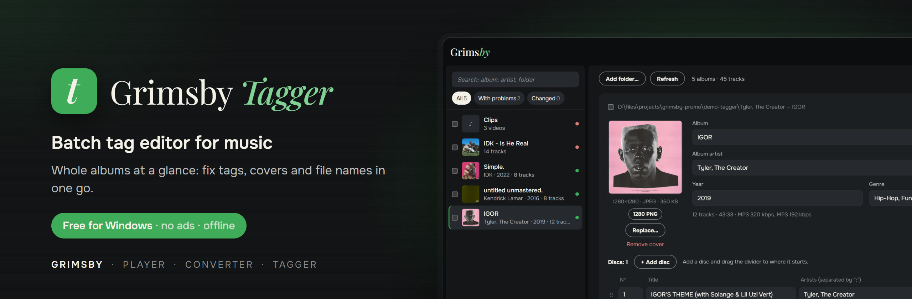

  <b>Tidy up the tags of your whole music library — album by album, not file by file.</b> 
  See every problem at once, fix it in a couple of clicks and save everything with one button. Now for videos too.

  
  
  
  
  

  <a href="https://github.com/maksimkhatskevich/grimsby-tagger/releases/latest"><b>⬇ Download for Windows</b></a>
  &nbsp;·&nbsp;
  <a href="#features">Features</a>
  &nbsp;·&nbsp;
  <a href="#your-files-are-safe">Safety</a>
  &nbsp;·&nbsp;
  <a href="#feedback">Feedback</a>

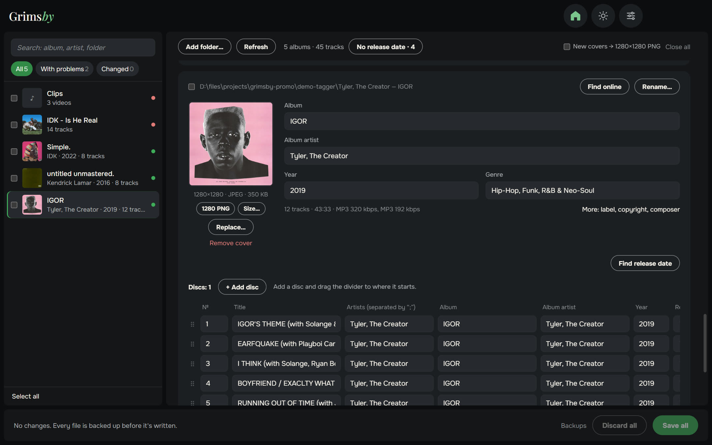

---

## Why Grimsby Tagger

Tags are what makes a collection look good in a player: the right album, year, artist, track numbers and cover. Downloaded music rarely arrives perfect — one album has no year, another has a missing cover, a third has broken Cyrillic. Classic tag editors show you a spreadsheet of thousands of files, and you fix them one row at a time.

**Grimsby Tagger thinks in albums.** Point it at a folder of any depth — it groups the files into albums, shows each one as a card with its cover and highlights what's wrong. Edit whatever you like, then **Save all** (Ctrl+S).

---

## Features

### 💿 Albums sort themselves out

An album is a folder plus the "Album" tag. Several albums in one folder are split apart; CD1/CD2 subfolders are joined into one album; files without tags stick to the album of their folder. Deluxe and standard editions from one folder become one card. A track in the wrong album? Drag it to the right one — on save it gets that album's tags and cover and moves to its folder.

### 🎬 Videos too

Music videos, concerts and other clips are edited just like music, in batches, right in the cards: MP4, M4V, WMV, MKV, WebM and MOV. The video is never re-encoded — only the tags and, where the format allows, the cover change.

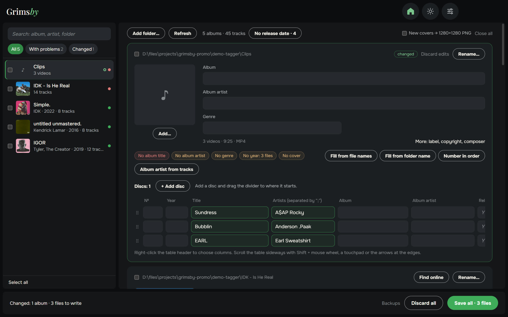

### 🩺 Problems in plain sight

Unreadable files, empty fields, mixed values inside one album, repeated track numbers, missing or small covers, garbled text from old encodings, damaged tags. Hover over a problem badge to see what exactly is wrong and how to fix it; **Rewrite tags** repairs damaged ones. The **"With problems"** filter shows only the albums that need attention.

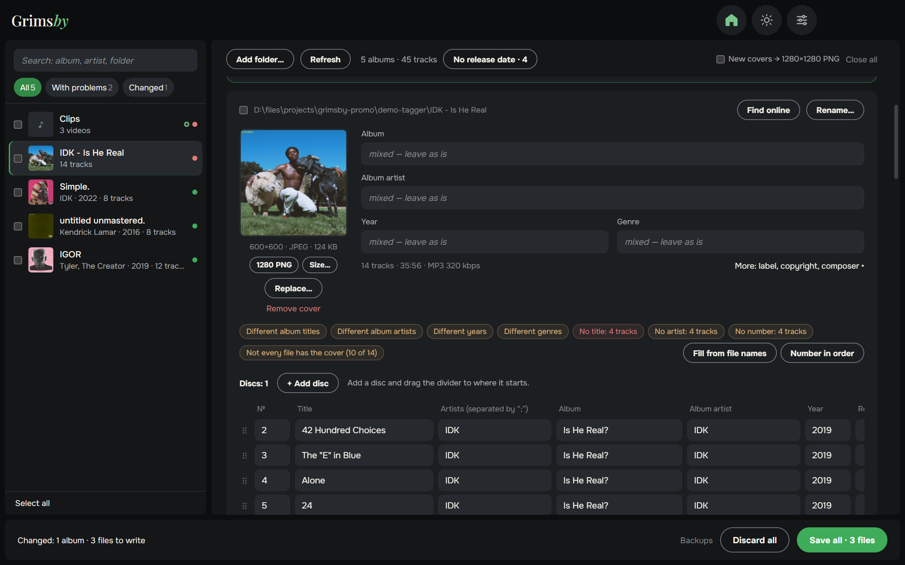

### 🪄 One-click fixes

They fill only what's empty, never overwriting your data:

- titles, artists and numbers from file names like `01. Artist — Title`;
- album, artist and year from the folder name like `Artist — Album (2021)`;
- track numbers in order, album artist from the tracks;
- fixing the encoding, embedding `cover.jpg` from the folder.

### 🌐 Find the album online

Paste a link to the album from a music service — or just type `Artist — Album`. Grimsby finds the release in open music databases, **matches the tracks to your files** by title, length and number, and lets you choose which fields to take. Fields where your album already has a different value are left alone by default.

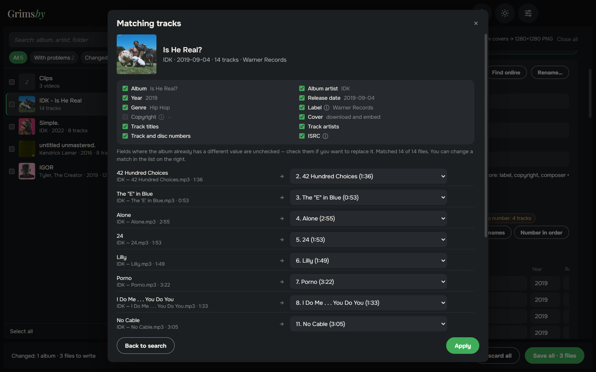

### ✏️ Rename files by a template

Templates like `%artist% — %title%` or `[%disc%-]%track% %title%`, optionally for album folders too. Preview before renaming, duplicate check — and **Undo rename** if you change your mind.

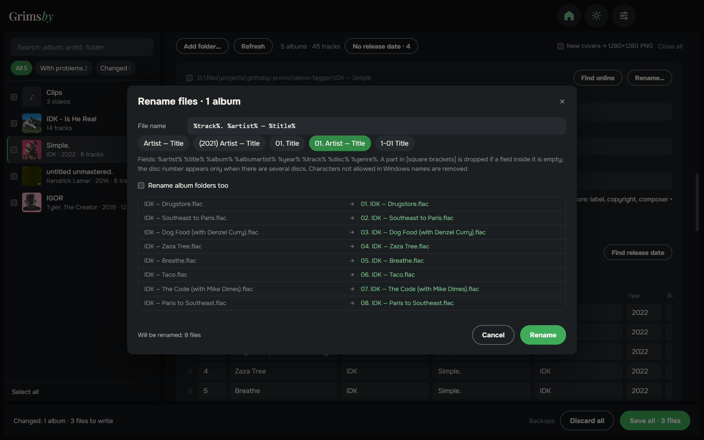

### 📋 Every file’s tags in one table

Under each card, a table shows one row per file and a column per tag — like a spreadsheet, but in the same style as the rest of the app. Click a cell to edit it (in Settings you can switch to **Double click**), right-click the header to choose **Columns**, scroll sideways with Shift + wheel. Works for videos too.

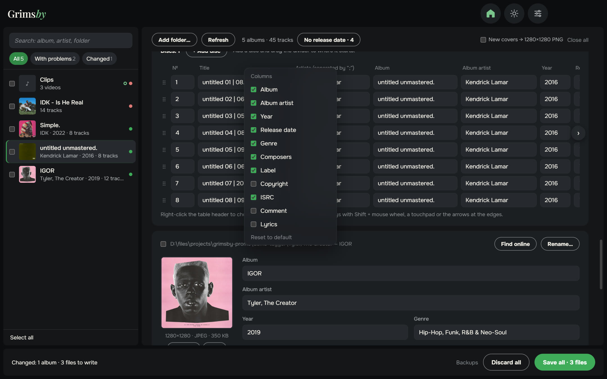

### 🖼 Cover of any size

**Size…** sets any width and height or **Square 1:1**; if the proportions differ — crop to center, add borders or stretch. The preview shows the result right away, and you can drag the frame edges to crop or stretch by hand. Save into the tags as PNG or JPEG, or keep the result as a separate image with **Save as file…**. The 1280×1280 PNG standard is still one click away.

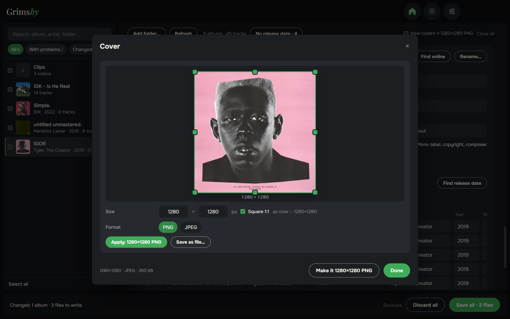

### 📅 Release date from the internet

**Find release date** looks up the album’s full release date in online music databases, takes the earliest one and writes it into the tags along with your other edits.

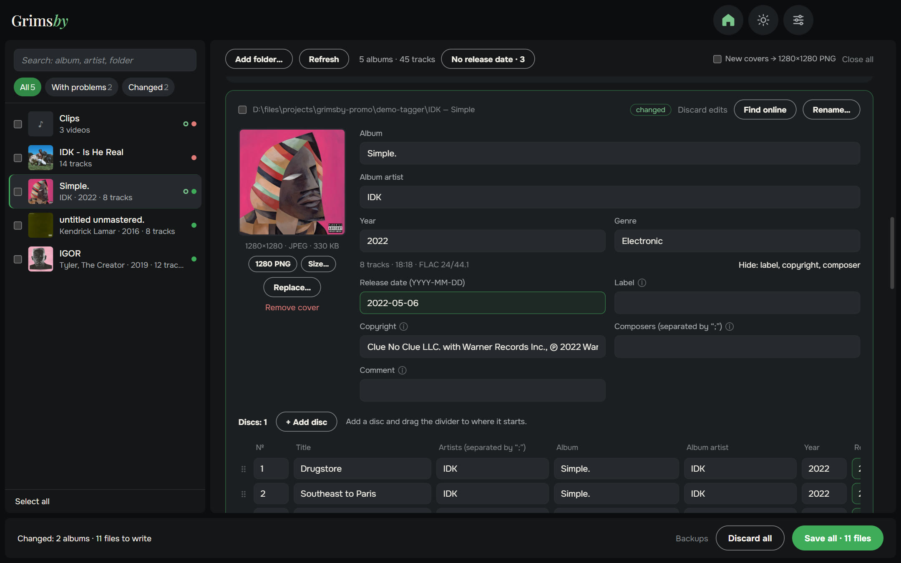

### 🗓 Albums without a release date

The **No release date** button above the list opens every album without a full date: filters for no date, year only and found, plus search. **Find dates** looks dates up online for all ticked albums at once, **Fix** handles one album — online or by hand. Dates are always YYYY-MM-DD, and the album year follows them.

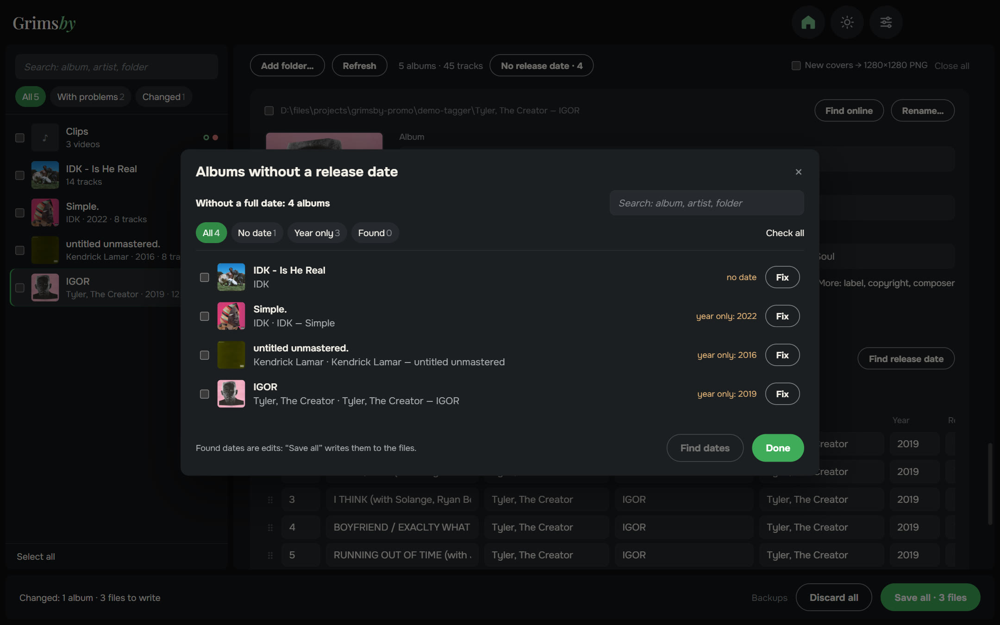

### 📦 Batch editing and more

- Tick several albums → set album artist, year, genre or label for all of them at once; merge them into one album.
- Extra fields: label, copyright, composer, comment, ISRC, lyrics.
- Covers: replace, drag a picture onto the cover, view full size, crop to a square, bring to the 1280×1280 PNG standard, or download from the release found online.

### ⚡ Smooth on a big library

The album feed draws only what is on screen: with 300 albums scrolling is four times smoother, the app uses less memory and typing is faster. Backups are cleaned up during a large write, so the backup folder never grows beyond 5 GB. WAV tags in UTF-8 with Cyrillic and other alphabets are read and written correctly.

### ⚙️ Settings and your own look

Settings are split into sections — Appearance, Language, Updates and the app’s own — with a search at the top that shows only what matches. Theme: dark, light or as in Windows; the app color: ten ready-made colors or your own. Updates: notify only, install automatically or don’t check.

🌍 **9 languages:** English, Russian, Spanish, Portuguese, German, French, Chinese, Japanese and Korean — switch in Settings, it changes right away.

The light theme is one click away — the sun button at the top.

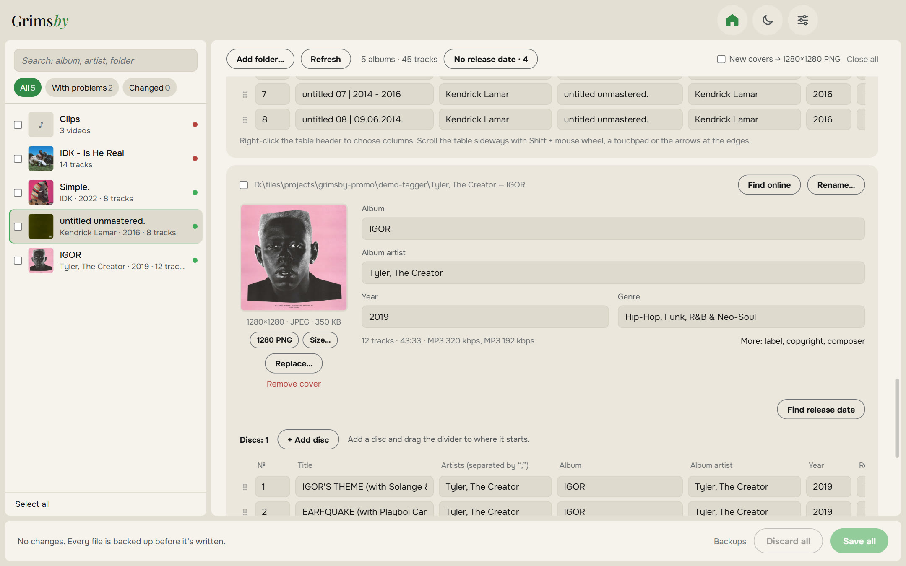

---

## Your files are safe

- Only tags are written — **the audio and video are never re-encoded**.
- Before editing, every file is copied to a backup folder (kept for 14 days).
- After writing, the file is read back. If it doesn't open or its length has changed, the original is restored automatically.

Music: MP3, FLAC, M4A (AAC/ALAC), OGG, Opus, WAV, AIFF, APE, WavPack, WMA and DSF. Video: MP4, M4V, WMV, MKV, WebM and MOV.

---

## Download and install

1. Open the **[latest release](https://github.com/maksimkhatskevich/grimsby-tagger/releases/latest)** page and download the installer `.exe`.
2. Run it. Windows may show a blue "Windows protected your PC" window — that's a normal warning for apps without a paid code-signing certificate. Click **More info → Run anyway**.
   The installer has been checked on VirusTotal: [0 of 68 antivirus engines flag it](https://www.virustotal.com/gui/file/af172f8680328cf11d6d5f5cdcf970edd40949a2aa5ae664b6adc701d932ddf6) (version 1.4.0).
3. Click **Add folder…** or drag your music folder into the window.

**Requirements:** Windows 10 or 11 (64-bit). Internet is only needed to find albums online.

---

## Privacy

Grimsby Tagger works on your computer. No accounts, no ads, no analytics. It goes online only when you search for an album yourself, and to check for updates.

---

## Grimsby apps

<table>
  <tr>
    <td align="center" width="25%"><a href="https://github.com/maksimkhatskevich/grimsby-releases"> <b>Grimsby Player</b></a> Offline music & video player for your downloaded collection</td>
    <td align="center" width="25%"><a href="https://github.com/maksimkhatskevich/grimsby-converter"> <b>Grimsby Converter</b></a> Video, audio, photos and documents — converted offline</td>
    <td align="center" width="25%"> <b>Grimsby Tagger</b> </td>
    <td align="center" width="25%"><a href="https://github.com/maksimkhatskevich/grimsby-prompter"> <b>Grimsby Prompter</b></a> A simple teleprompter that follows your voice</td>
  </tr>
  <tr>
    <td align="center" width="25%"><a href="https://github.com/maksimkhatskevich/grimsby-helper"> <b>Grimsby Helper</b></a> PC health at a glance: processes, temperatures, cleanup</td>
    <td align="center" width="25%"><a href="https://github.com/maksimkhatskevich/grimsby-studio"> <b>Grimsby Studio</b></a> Video editor with animated music inserts</td>
    <td align="center" width="25%"><a href="https://github.com/maksimkhatskevich/grimsby-notes"> <b>Grimsby Notes</b></a> Tasks, projects, notes and calendar in one window</td>
  </tr>
</table>

---

## Feedback

Found a bug, have an idea or just want to say thanks? Get in touch:

- ✉️ email: **[grimsbyy@gmail.com](mailto:grimsbyy@gmail.com)**
- 🐞 bugs and ideas: [Issues](https://github.com/maksimkhatskevich/grimsby-tagger/issues)
- 📣 Telegram: [@itsgrimsby](https://t.me/itsgrimsby) (in Russian)

---

## Licenses

Grimsby Tagger uses open-source components, including Electron, React, music-metadata and TagLib#. The full list with license texts is in `THIRD_PARTY_NOTICES.txt` in the program folder. Album covers in the screenshots belong to their rights holders and are shown as an example of a personal library.

© 2026 Grimsby

