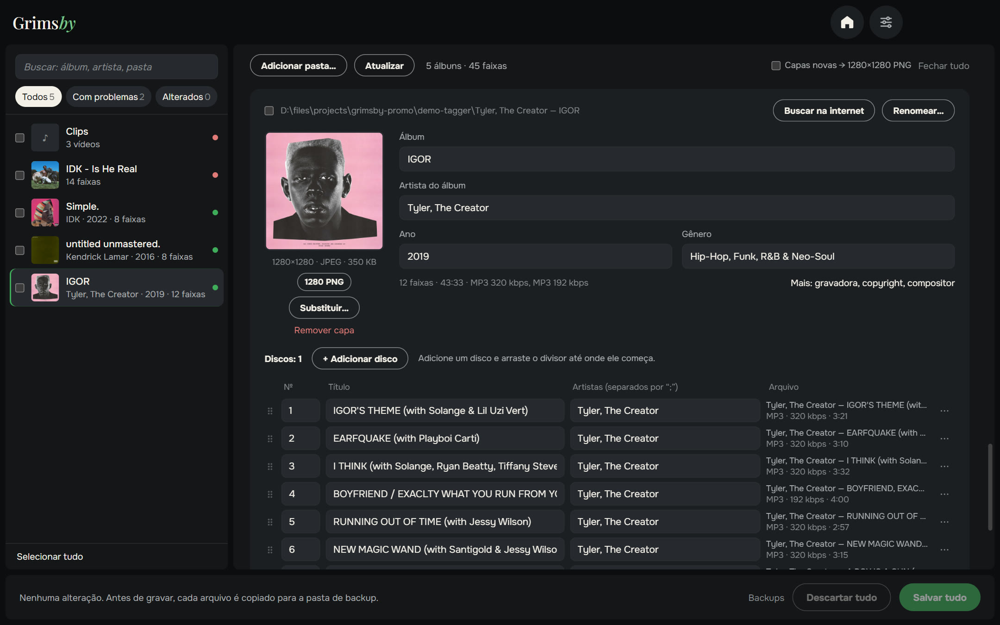
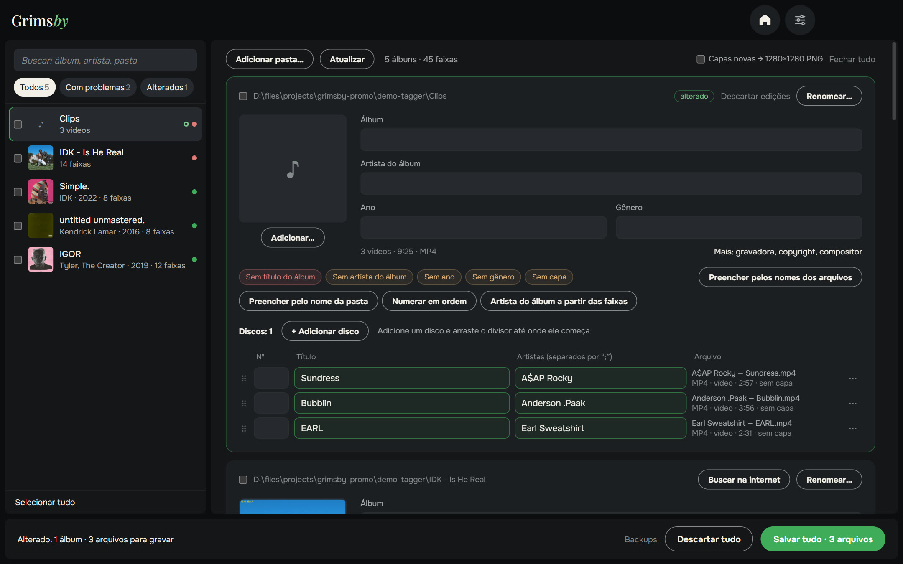
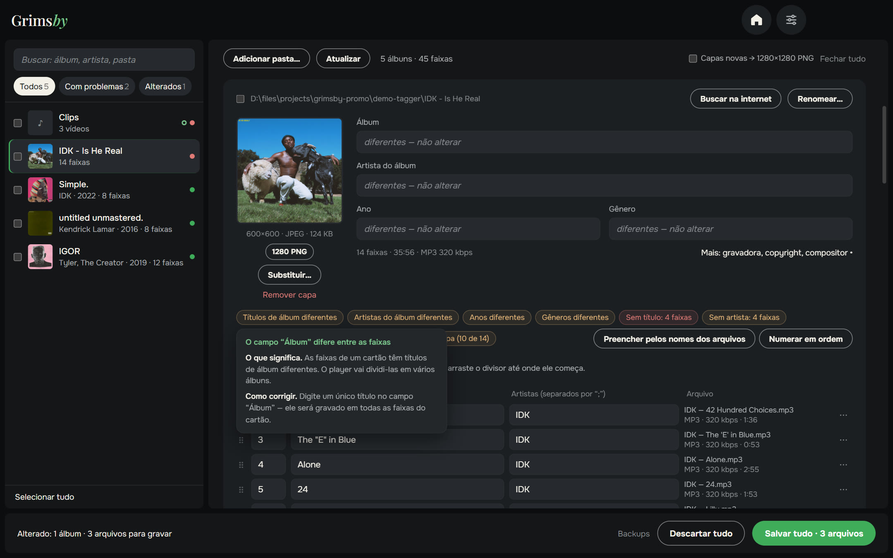
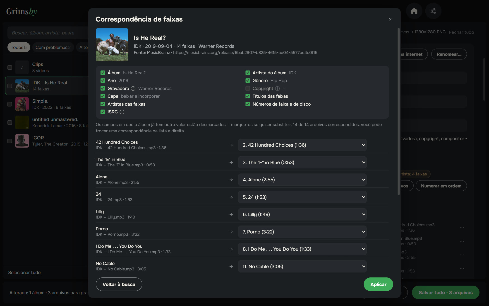
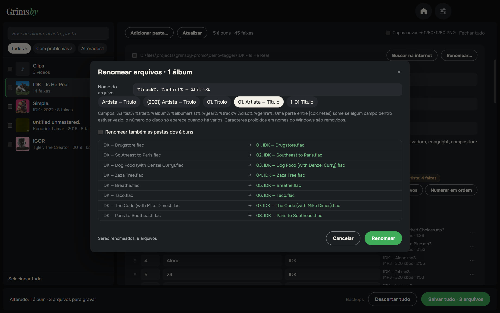
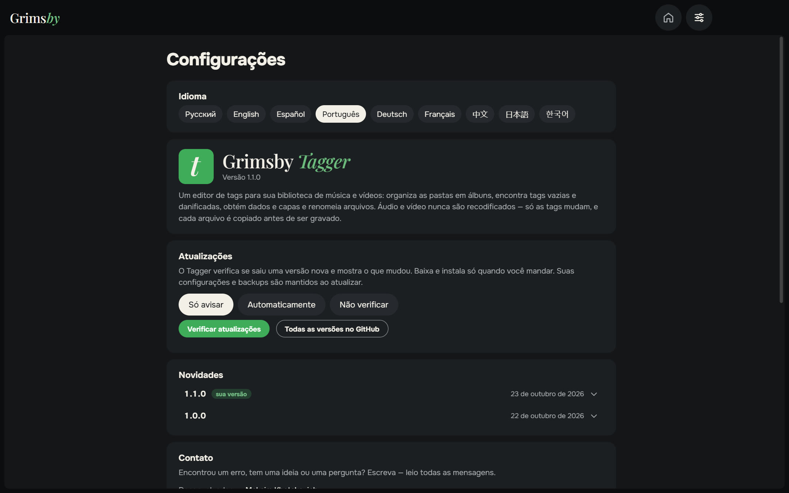
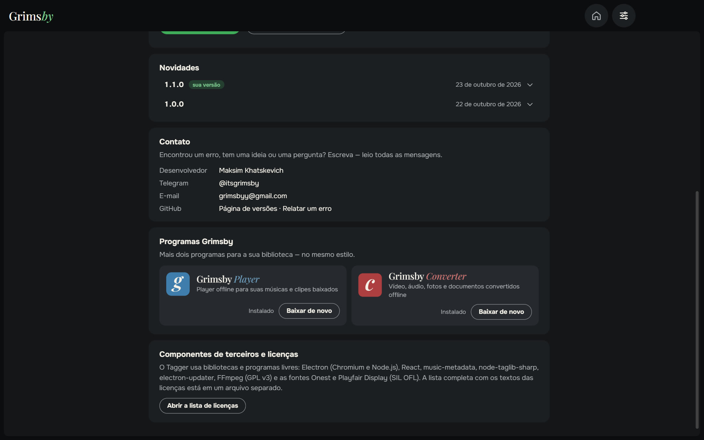

  <a href="README.md">English</a> ·
  <a href="README.ru.md">Русский</a> ·
  <a href="README.es.md">Español</a> ·
  <b>Português</b> ·
  <a href="README.de.md">Deutsch</a> ·
  <a href="README.fr.md">Français</a> ·
  <a href="README.zh.md">中文</a> ·
  <a href="README.ja.md">日本語</a> ·
  <a href="README.ko.md">한국어</a>

  

  <b>Organize as tags de toda a sua biblioteca de música — por álbum, não arquivo por arquivo.</b> 
  Veja todos os problemas de uma vez, corrija em dois cliques e salve tudo com um botão. Agora também para vídeos.

  
  
  
  
  

  <a href="https://github.com/maksimkhatskevich/grimsby-tagger/releases/latest"><b>⬇ Baixar para Windows</b></a>
  &nbsp;·&nbsp;
  <a href="#recursos">Recursos</a>
  &nbsp;·&nbsp;
  <a href="#seus-arquivos-estão-seguros">Segurança</a>
  &nbsp;·&nbsp;
  <a href="#contato">Contato</a>

---

## Por que o Grimsby Tagger

As tags fazem a coleção ficar bonita no player: álbum, ano, artista, números das faixas e capa certos. Música baixada quase nunca chega perfeita — um álbum sem ano, outro sem capa, outro com caracteres quebrados. Os editores clássicos mostram uma planilha com milhares de arquivos para corrigir linha por linha.

**O Grimsby Tagger pensa em álbuns.** Aponte uma pasta de qualquer profundidade — ele agrupa os arquivos em álbuns, mostra cada um como um cartão com a capa e destaca o que está errado. Edite o que quiser e clique em **Salvar tudo** (Ctrl+S).

---

## Recursos

### 💿 Os álbuns se organizam sozinhos

Um álbum é uma pasta mais a tag «Álbum». Vários álbuns numa pasta são separados; subpastas CD1/CD2 viram um só álbum; arquivos sem tags entram no álbum da sua pasta. Edição normal e deluxe da mesma pasta formam um só cartão. Faixa no álbum errado? Arraste para o certo — ao salvar ela recebe as tags e a capa do álbum e vai para a pasta dele.

### 🎬 Vídeos também

Clipes, shows e outros vídeos são editados como música, em lote, direto nos cartões: MP4, M4V, WMV, MKV, WebM e MOV. O vídeo nunca é recodificado — só mudam as tags e, quando o formato permite, a capa.

### 🩺 Problemas à vista

Arquivos ilegíveis, campos vazios, valores misturados no álbum, números repetidos, capa faltando ou pequena, texto quebrado por codificações antigas, tags danificadas. Passe o mouse sobre o aviso para ver o que está errado e como corrigir; **Regravar tags** conserta as danificadas. O filtro **«Com problemas»** mostra só os álbuns que precisam de atenção.

### 🪄 Correções com um clique

Só preenchem o que está vazio, sem sobrescrever seus dados:

- títulos, artistas e números a partir de nomes como `01. Artista — Título`;
- álbum, artista e ano a partir do nome da pasta `Artista — Álbum (2021)`;
- numeração em ordem, artista do álbum a partir das faixas;
- correção de codificação, incorporar `cover.jpg` da pasta.

### 🌐 Encontre o álbum na internet

Cole um link do álbum de um serviço de música — ou digite `Artista — Álbum`. O Grimsby encontra o lançamento em bancos de dados musicais abertos, **associa as faixas aos seus arquivos** por título, duração e número e deixa você escolher quais campos usar. Campos que já têm outro valor ficam como estão por padrão.

### ✏️ Renomear por modelo

Modelos como `%artist% — %title%` ou `[%disc%-]%track% %title%`, também para as pastas dos álbuns, se quiser. Prévia, verificação de duplicatas e **Desfazer renomeação** se mudar de ideia.

### 📦 Edição em lote e mais

- Marque vários álbuns → artista do álbum, ano, gênero ou gravadora para todos de uma vez; junte-os em um só álbum.
- Campos extras: gravadora, copyright, compositor, comentário, ISRC, letra.
- Capas: trocar, arrastar uma imagem, ver em tamanho real, recortar em quadrado, levar ao padrão PNG 1280×1280 ou baixar do lançamento encontrado.

### ⚙️ Configurações em uma página

Idioma, atualizações (só avisar, automaticamente ou não verificar), novidades, contato e os outros apps Grimsby — tudo em uma página. A janela lembra o tamanho e a posição.

🌍 **9 idiomas:** inglês, russo, espanhol, português, alemão, francês, chinês, japonês e coreano — troque nas Configurações, muda na hora.

---

## Seus arquivos estão seguros

- Só as tags são gravadas — **áudio e vídeo nunca são recodificados**.
- Antes de editar, cada arquivo é copiado para uma pasta de backup (guardado por 14 dias).
- Depois de gravar, o arquivo é lido de novo. Se não abrir ou a duração mudar, o original volta automaticamente.

Música: MP3, FLAC, M4A (AAC/ALAC), OGG, Opus, WAV, AIFF, APE, WavPack, WMA e DSF. Vídeo: MP4, M4V, WMV, MKV, WebM e MOV.

---

## Baixar e instalar

1. Abra a página da **[versão mais recente](https://github.com/maksimkhatskevich/grimsby-tagger/releases/latest)** e baixe o instalador `.exe`.
2. Execute-o. O Windows pode mostrar uma janela azul «O Windows protegeu o computador» — é um aviso normal para programas sem certificado de assinatura pago. Clique em **Mais informações → Executar assim mesmo**.
   O instalador foi verificado no VirusTotal: [nenhum dos 67 antivírus encontrou nada](https://www.virustotal.com/gui/file/e4dfabdb0c5f60a9fc7c6c42132a6e3492d6ef2414fcf21a93ebd759987a35e0) (versão 1.1.0).
3. Clique em **Adicionar pasta…** ou arraste a pasta de música para a janela.

**Requisitos:** Windows 10 ou 11 (64 bits). Internet só é necessária para buscar álbuns.

---

## Privacidade

O Grimsby Tagger funciona no seu computador. Sem contas, sem anúncios, sem análises. Só se conecta quando você busca um álbum e para verificar atualizações.

---

## Os apps Grimsby

<table>
  <tr>
    <td align="center" width="33%"><a href="https://github.com/maksimkhatskevich/grimsby-releases/blob/main/README.pt.md"> <b>Grimsby Player</b></a> Player offline para suas músicas e clipes baixados</td>
    <td align="center" width="33%"><a href="https://github.com/maksimkhatskevich/grimsby-converter/blob/main/README.pt.md"> <b>Grimsby Converter</b></a> Vídeo, áudio, fotos e documentos convertidos offline</td>
    <td align="center" width="33%"> <b>Grimsby Tagger</b> </td>
  </tr>
</table>

---

## Contato

Encontrou um erro, tem uma ideia ou só quer agradecer? Escreva:

- ✉️ e-mail: **[grimsbyy@gmail.com](mailto:grimsbyy@gmail.com)**
- 🐞 erros e ideias: [Issues](https://github.com/maksimkhatskevich/grimsby-tagger/issues)
- 📣 Telegram: [@itsgrimsby](https://t.me/itsgrimsby) (em russo)

---

## Licenças

O Grimsby Tagger usa componentes de código aberto, incluindo Electron, React, music-metadata e TagLib#. A lista completa com os textos das licenças está em `THIRD_PARTY_NOTICES.txt`, na pasta do programa. As capas nas capturas pertencem aos seus titulares e aparecem como exemplo de uma biblioteca pessoal.

© 2026 Grimsby

