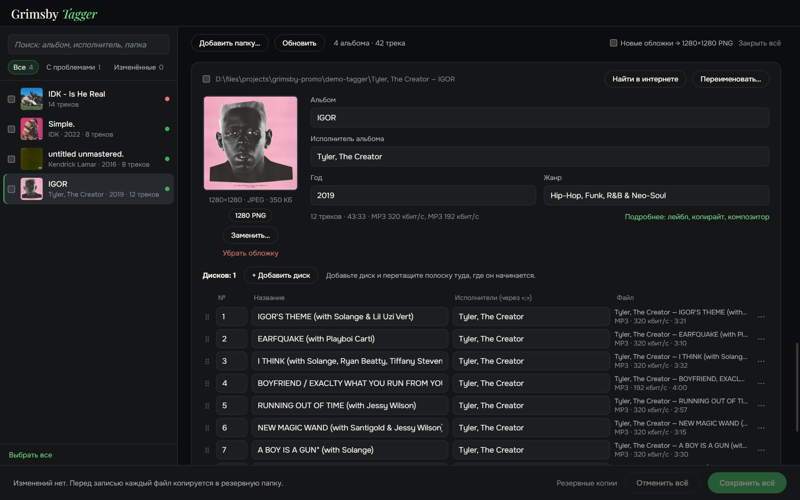
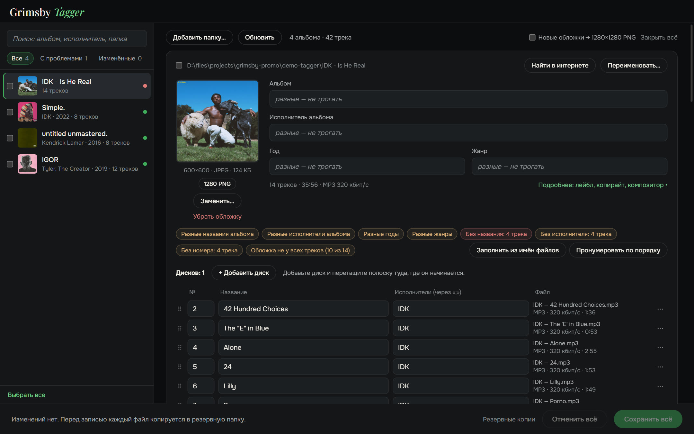
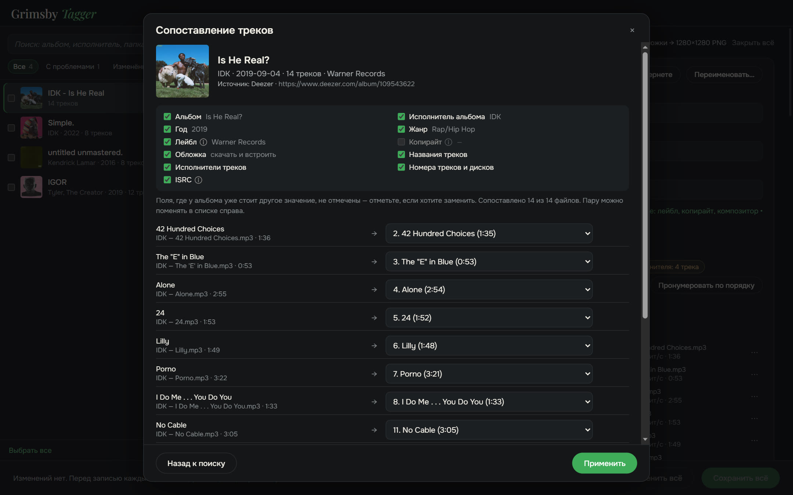
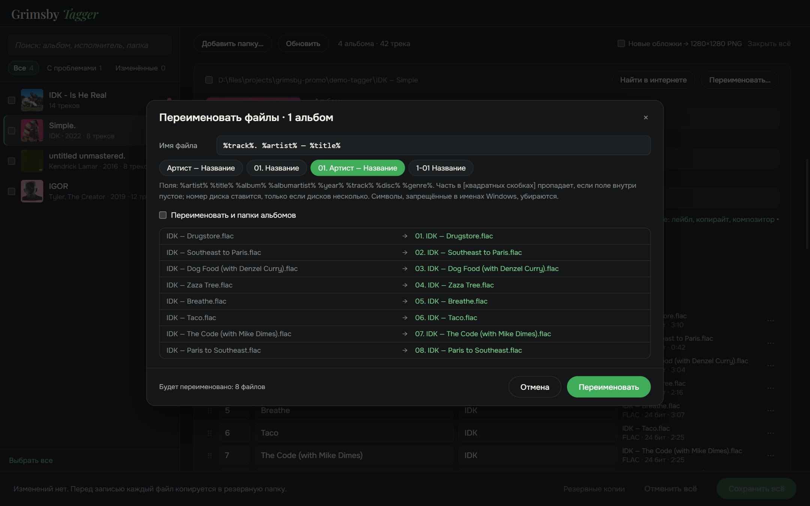

  <a href="README.md">English</a> ·
  <b>Русский</b>

  

  <b>Наведите порядок в тегах всей медиатеки — альбомами, а не по одному файлу.</b> 
  Все проблемы видны сразу, исправляются в пару кликов и сохраняются одной кнопкой.

  
  
  
  

  <a href="https://github.com/maksimkhatskevich/grimsby-tagger/releases/latest"><b>⬇ Скачать для Windows</b></a>
  &nbsp;·&nbsp;
  <a href="#возможности">Возможности</a>
  &nbsp;·&nbsp;
  <a href="#ваши-файлы-в-безопасности">Безопасность</a>
  &nbsp;·&nbsp;
  <a href="#обратная-связь">Обратная связь</a>

---

## Зачем Grimsby Tagger

Теги — это то, благодаря чему коллекция красиво выглядит в плеере: правильные альбом, год, исполнитель, номера треков и обложка.
Скачанная музыка редко приходит идеальной: у одного альбома нет года, у другого обложки, у третьего вместо кириллицы кракозябры.
Классические редакторы тегов показывают таблицу из тысяч файлов, и править приходится строчка за строчкой.

**Grimsby Tagger мыслит альбомами.** Укажите папку любой вложенности — он сам разложит файлы по альбомам,
покажет каждый карточкой с обложкой и подсветит, что не так. Правьте что угодно и нажмите **«Сохранить всё»** (Ctrl+S).

---

## Возможности

### 💿 Альбомы собираются сами

Альбом — это папка плюс тег «Альбом». Несколько альбомов в одной папке разделяются, подпапки CD1/CD2 или «Диск 2»
склеиваются в один альбом, файлы без тегов приклеиваются к альбому своей папки.
Обычное и делюкс-издание из одной папки — одна карточка, у каждого трека подписано его издание.

### 🩺 Проблемы на виду

Нечитаемые файлы, пустые поля, разнобой внутри альбома, повторы номеров,
нет обложки, маленькая или не у всех треков, кракозябры от старых кодировок, повреждённые теги.
Фильтр **«С проблемами»** оставит только альбомы, которым нужно внимание.

### 🪄 Исправления в один клик

Заполняют только пустое и ничего вашего не перезаписывают:

- названия, исполнители и номера из имён файлов вида `01. Исполнитель — Название`;
- альбом, исполнитель и год из имени папки вида `Исполнитель — Альбом (2021)`;
- нумерация по порядку, исполнитель альбома из треков;
- исправление кодировки, встраивание `cover.jpg` из папки.

### 🌐 Найти альбом в интернете

Вставьте ссылку на альбом из музыкального сервиса — или просто напишите `Исполнитель — Альбом`.
Grimsby найдёт релиз в музыкальных базах (MusicBrainz и других), **сам сопоставит треки с вашими файлами**
по названию, длительности и номеру и даст выбрать, какие поля взять. Поля, где у альбома уже стоит другое значение,
по умолчанию не трогаются.

### ✏️ Переименование по шаблону

Шаблоны вида `%artist% — %title%` или `[%disc%-]%track% %title%`, по желанию — и для папок альбомов.
Предпросмотр, проверка повторов и **«Отменить переименование»**, если передумали.

### 📦 Пакетная правка и не только

- Отметьте несколько альбомов → исполнитель альбома, год, жанр или лейбл для всех сразу; объединение в один альбом.
- Дополнительные поля: лейбл, копирайт, композитор, комментарий, ISRC, текст песни.
- Обложки: заменить, перетащить картинку на обложку, убрать или скачать из найденного релиза.

---

## Ваши файлы в безопасности

- Пишутся только теги — **звук не перекодируется**.
- Перед правкой каждый файл копируется в папку резервных копий (хранятся 14 дней).
- После записи файл перечитывается. Если он не открывается или изменилась длительность, оригинал возвращается сам.

Поддерживает MP3, FLAC, M4A (AAC/ALAC), OGG, Opus, WAV, AIFF, APE, WavPack, WMA и DSF.

---

## Скачать и установить

1. Откройте страницу **[последней версии](https://github.com/maksimkhatskevich/grimsby-tagger/releases/latest)** и скачайте установщик `.exe`.
2. Запустите его. Windows может показать синее окно «Система Windows защитила ваш компьютер» — это обычное
   предупреждение для программ без платного сертификата подписи. Нажмите **Подробнее → Выполнить в любом случае**.
3. Нажмите **«Добавить папку…»** или перетащите папку с музыкой в окно.

**Требования:** Windows 10 или 11 (64 бит). Интернет нужен только для поиска альбомов.

---

## Приватность

Grimsby Tagger работает на вашем компьютере. Без аккаунтов, рекламы и аналитики.
В интернет он выходит, только когда вы сами ищете альбом.

---

## Семейство Grimsby

<table>
  <tr>
    <td align="center" width="33%"><a href="https://github.com/maksimkhatskevich/grimsby-releases/blob/main/README.ru.md"> <b>Grimsby Player</b></a> Офлайн-плеер для скачанной музыки и клипов</td>
    <td align="center" width="33%"><a href="https://github.com/maksimkhatskevich/grimsby-converter/blob/main/README.ru.md"> <b>Grimsby Converter</b></a> Видео, аудио, фото и документы — офлайн</td>
    <td align="center" width="33%"> <b>Grimsby Tagger</b> Вы здесь</td>
  </tr>
</table>

---

## Обратная связь

Нашли ошибку, есть идея или просто хотите сказать спасибо? Пишите:

- ✉️ почта: **[grimsbyy@gmail.com](mailto:grimsbyy@gmail.com)**
- 🐞 ошибки и идеи: [Issues](https://github.com/maksimkhatskevich/grimsby-tagger/issues)
- 📣 Telegram: [@itsgrimsby](https://t.me/itsgrimsby)

---

## Лицензии

Grimsby Tagger использует компоненты с открытым кодом, в том числе Electron, React, music-metadata и TagLib#.
Полный список с текстами лицензий — в файле `THIRD_PARTY_NOTICES.txt` в папке программы.
Обложки альбомов на скриншотах принадлежат правообладателям и показаны как пример личной медиатеки.

© 2026 Grimsby

