

  <a href="README.md">English</a> ·
  <b>Русский</b> ·
  <a href="README.es.md">Español</a> ·
  <a href="README.pt.md">Português</a> ·
  <a href="README.de.md">Deutsch</a> ·
  <a href="README.fr.md">Français</a> ·
  <a href="README.zh.md">中文</a> ·
  <a href="README.ja.md">日本語</a> ·
  <a href="README.ko.md">한국어</a>

  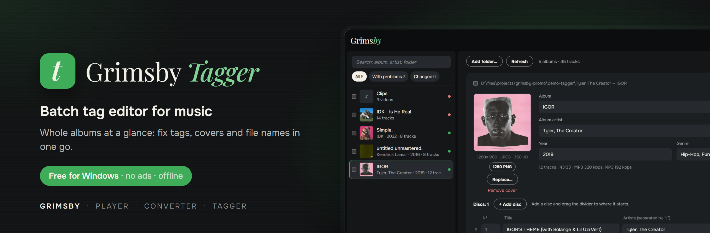

  <b>Наведите порядок в тегах всей медиатеки — альбомами, а не по одному файлу.</b> 
  Все проблемы видны сразу, исправляются в пару кликов и сохраняются одной кнопкой. Теперь и для видео.

  
  
  
  
  

  <a href="https://github.com/maksimkhatskevich/grimsby-tagger/releases/latest"><b>⬇ Скачать для Windows</b></a>
  &nbsp;·&nbsp;
  <a href="#возможности">Возможности</a>
  &nbsp;·&nbsp;
  <a href="#ваши-файлы-в-безопасности">Безопасность</a>
  &nbsp;·&nbsp;
  <a href="#обратная-связь">Обратная связь</a>

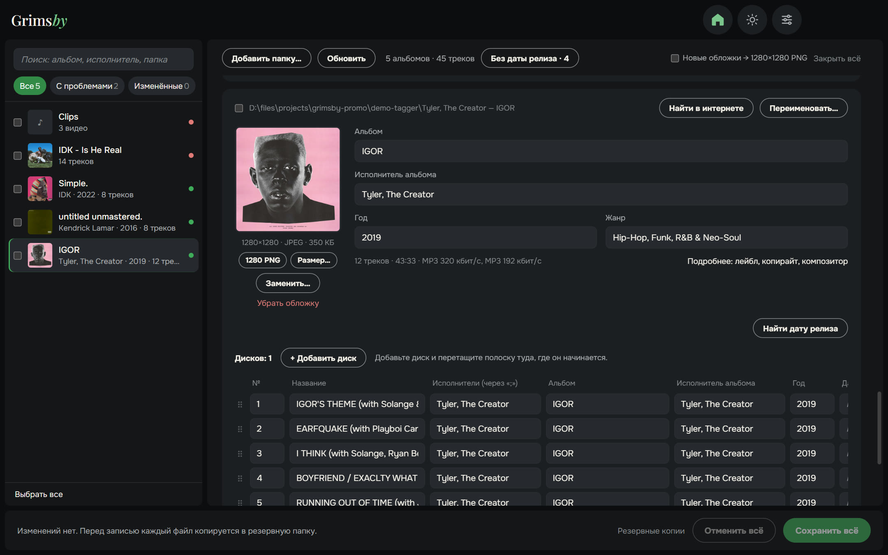

---

## Зачем Grimsby Tagger

Теги — это то, благодаря чему коллекция красиво выглядит в плеере: правильные альбом, год, исполнитель, номера треков и обложка. Скачанная музыка редко приходит идеальной: у одного альбома нет года, у другого обложки, у третьего вместо кириллицы кракозябры. Классические редакторы тегов показывают таблицу из тысяч файлов, и править приходится строчка за строчкой.

**Grimsby Tagger мыслит альбомами.** Укажите папку любой вложенности — он сам разложит файлы по альбомам, покажет каждый карточкой с обложкой и подсветит, что не так. Правьте что угодно и нажмите **«Сохранить всё»** (Ctrl+S).

---

## Возможности

### 💿 Альбомы собираются сами

Альбом — это папка плюс тег «Альбом». Несколько альбомов в одной папке разделяются, подпапки CD1/CD2 склеиваются в один альбом, файлы без тегов приклеиваются к альбому своей папки. Обычное и делюкс-издание из одной папки — одна карточка. Трек попал не в тот альбом? Перетащите его в нужный — при сохранении он получит теги и обложку альбома и переедет в его папку.

### 🎬 И видео тоже

Клипы, концерты и другие ролики правятся так же, как музыка, — пачками, прямо в карточках: MP4, M4V, WMV, MKV, WebM и MOV. Видео не перекодируется — меняются только теги и, где формат позволяет, обложка.

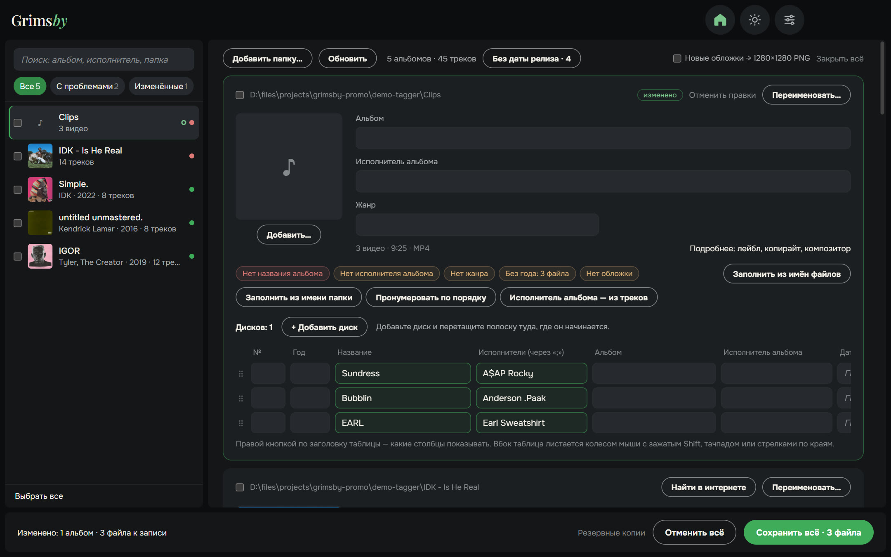

### 🩺 Проблемы на виду

Нечитаемые файлы, пустые поля, разнобой внутри альбома, повторы номеров, нет обложки или она маленькая, кракозябры от старых кодировок, повреждённые теги. Наведите на значок проблемы — подсказка объяснит, что именно не так и как исправить; кнопка **«Переписать теги»** чинит повреждённые. Фильтр **«С проблемами»** оставит только альбомы, которым нужно внимание.

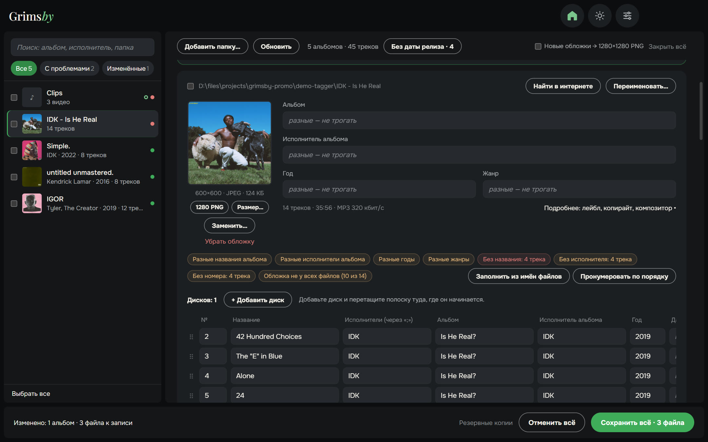

### 🪄 Исправления в один клик

Заполняют только пустое и ничего вашего не перезаписывают:

- названия, исполнители и номера из имён файлов вида `01. Исполнитель — Название`;
- альбом, исполнитель и год из имени папки вида `Исполнитель — Альбом (2021)`;
- нумерация по порядку, исполнитель альбома из треков;
- исправление кодировки, встраивание `cover.jpg` из папки.

### 🌐 Найти альбом в интернете

Вставьте ссылку на альбом из музыкального сервиса — или просто напишите `Исполнитель — Альбом`. Grimsby найдёт релиз в открытых музыкальных базах, **сам сопоставит треки с вашими файлами** по названию, длительности и номеру и даст выбрать, какие поля взять. Поля, где у альбома уже стоит другое значение, по умолчанию не трогаются.

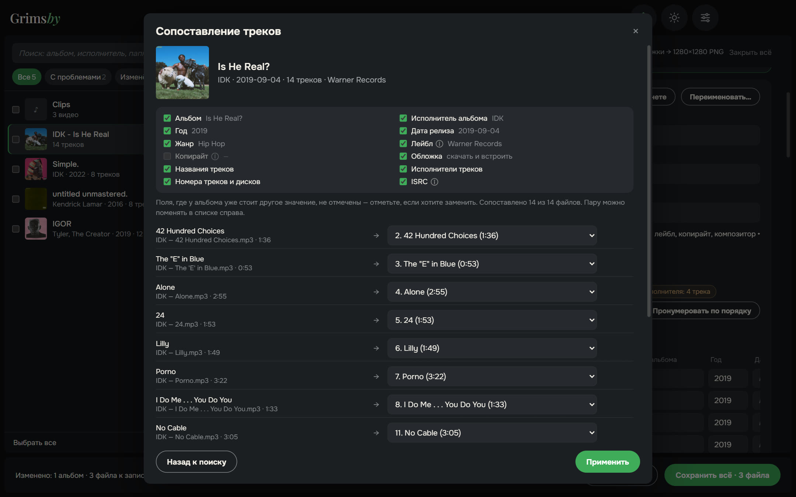

### ✏️ Переименование по шаблону

Шаблоны вида `%artist% — %title%` или `[%disc%-]%track% %title%`, по желанию — и для папок альбомов. Предпросмотр, проверка повторов и **«Отменить переименование»**, если передумали.

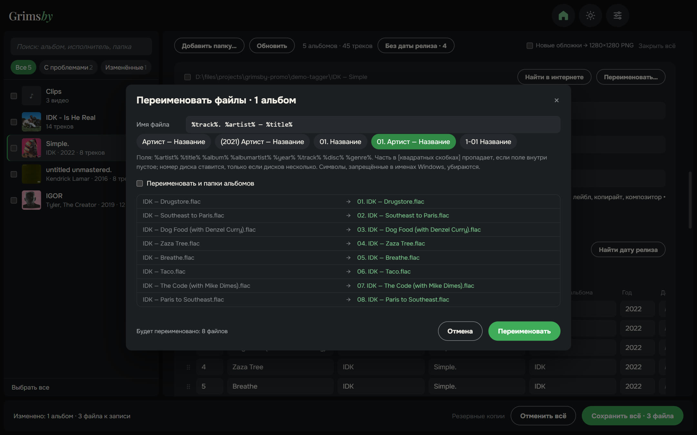

### 📋 Теги каждого файла в одной таблице

Под каждой карточкой — таблица: строка на каждый файл, столбец на каждый тег, как в электронной таблице, но в том же стиле, что и вся программа. Щелчок по ячейке — правка (в настройках можно выбрать **«Двойной клик»**), правая кнопка по заголовку — **«Столбцы»**, вбок — Shift + колесо. Для видео так же.

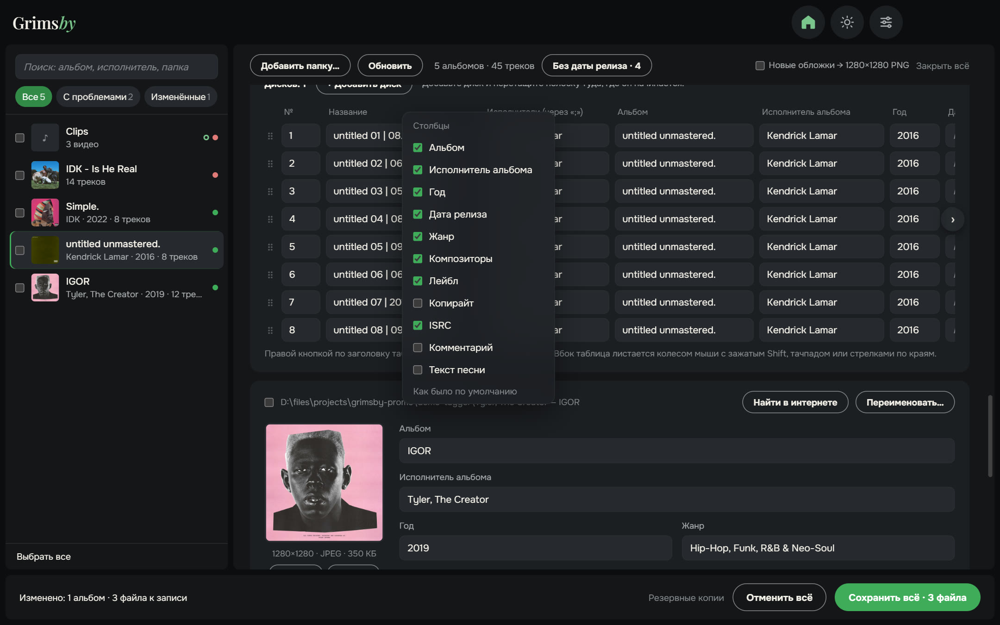

### 🖼 Обложка любого размера

**«Размер…»** задаёт любую ширину и высоту или **«Квадрат 1:1»**; если пропорции другие — обрезать по центру, добавить поля или растянуть. Превью сразу показывает результат, а рамку можно тянуть за края мышью, чтобы обрезать или растянуть вручную. Записать в теги как PNG или JPEG — или сохранить отдельной картинкой кнопкой **«Сохранить как файл…»**. Стандарт PNG 1280×1280 по-прежнему в один клик.

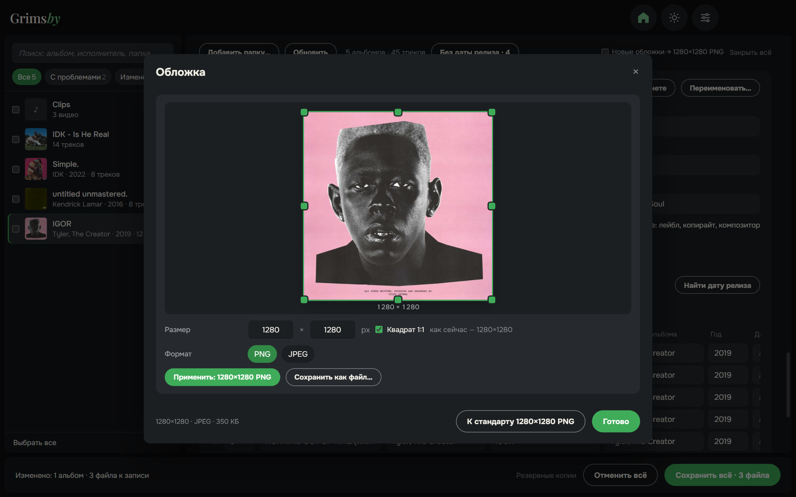

### 📅 Дата релиза из интернета

**«Найти дату релиза»** ищет полную дату выхода альбома в музыкальных базах в интернете, берёт самую раннюю и записывает её в теги вместе с остальными правками.

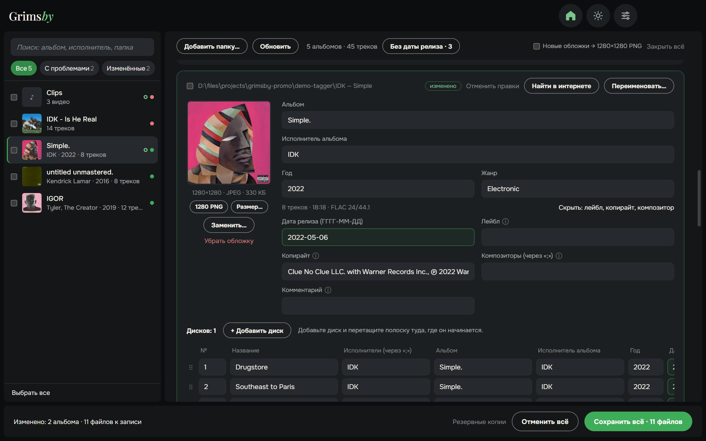

### 🗓 Альбомы без даты релиза

Кнопка **«Без даты релиза»** над списком открывает все альбомы без полной даты: фильтры «Нет даты», «Только год», «Найдено» и поиск. **«Найти даты»** ищет в интернете сразу для всех отмеченных, **«Исправить»** — для одного альбома, из интернета или вручную. Дата всегда в формате ГГГГ-ММ-ДД, год альбома берётся из неё.

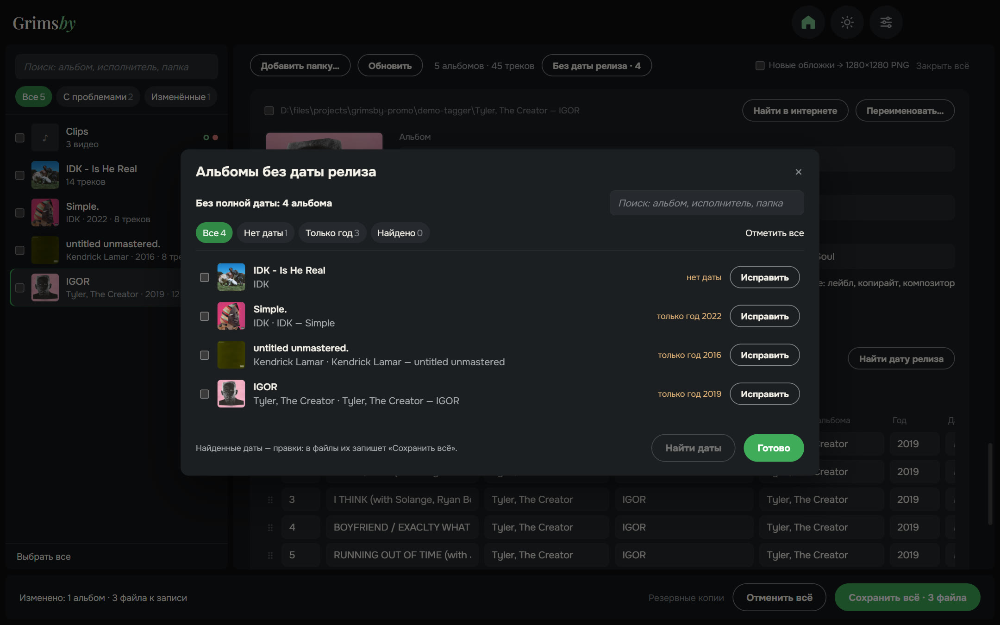

### 📦 Пакетная правка и не только

- Отметьте несколько альбомов → исполнитель альбома, год, жанр или лейбл для всех сразу; объединение в один альбом.
- Дополнительные поля: лейбл, копирайт, композитор, комментарий, ISRC, текст песни.
- Обложки: заменить, перетащить картинку на обложку, посмотреть в полном размере, обрезать до квадрата, привести к стандарту 1280×1280 PNG или скачать из найденного релиза.

### ⚙️ Настройки на одной странице

Язык, обновления (только сообщать, автоматически или не проверять), «Что нового», обратная связь и другие программы Grimsby — всё на одной странице. Окно запоминает размер и положение.

🌍 **9 языков:** русский, английский, испанский, португальский, немецкий, французский, китайский, японский и корейский — переключаются в настройках сразу.

Светлая тема — в один клик, кнопка с солнцем вверху.

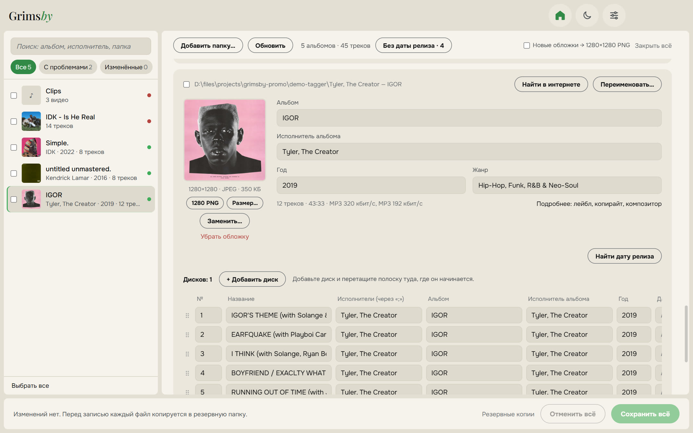

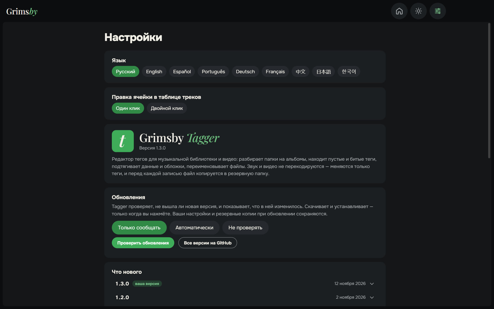

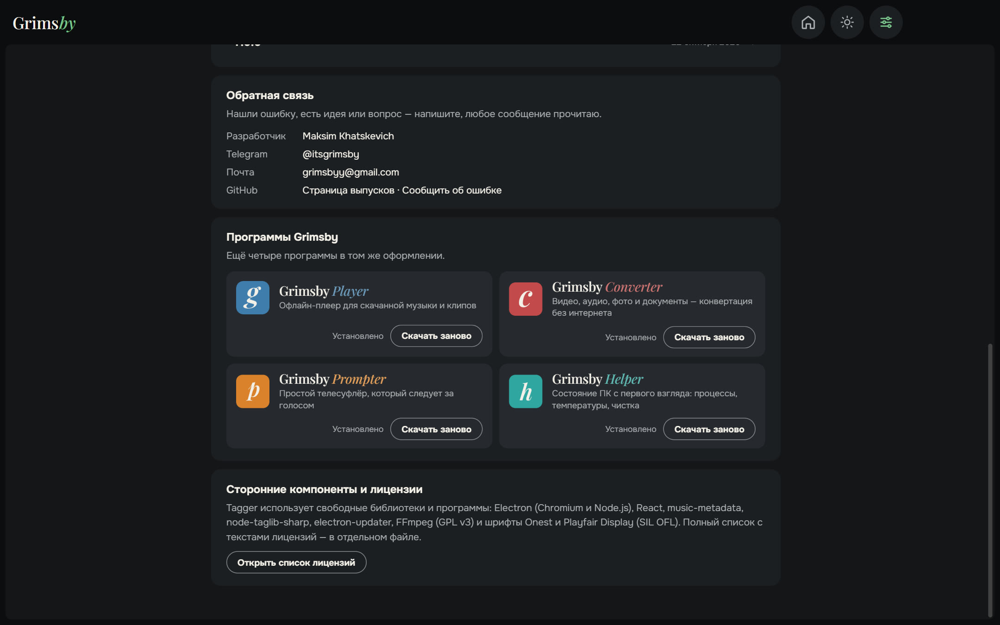

---

## Ваши файлы в безопасности

- Пишутся только теги — **звук и видео не перекодируются**.
- Перед правкой каждый файл копируется в папку резервных копий (хранятся 14 дней).
- После записи файл перечитывается. Если он не открывается или изменилась длительность, оригинал возвращается сам.

Музыка: MP3, FLAC, M4A (AAC/ALAC), OGG, Opus, WAV, AIFF, APE, WavPack, WMA и DSF. Видео: MP4, M4V, WMV, MKV, WebM и MOV.

---

## Скачать и установить

1. Откройте страницу **[последней версии](https://github.com/maksimkhatskevich/grimsby-tagger/releases/latest)** и скачайте установщик `.exe`.
2. Запустите его. Windows может показать синее окно «Система Windows защитила ваш компьютер» — это обычное предупреждение для программ без платного сертификата подписи. Нажмите **Подробнее → Выполнить в любом случае**.
   Установщик проверен на VirusTotal: [ни один из 67 антивирусов ничего не нашёл](https://www.virustotal.com/gui/file/6bb0a80156c65ba9162d62ad8a0d80e0615c3cb57cf728ce70f4d0971fccaf5b) (версия 1.3.0).
3. Нажмите **«Добавить папку…»** или перетащите папку с музыкой в окно.

**Требования:** Windows 10 или 11 (64 бит). Интернет нужен только для поиска альбомов.

---

## Приватность

Grimsby Tagger работает на вашем компьютере. Без аккаунтов, рекламы и аналитики. В интернет он выходит, только когда вы сами ищете альбом, и чтобы проверить обновления.

---

## Программы Grimsby

<table>
  <tr>
    <td align="center" width="20%"><a href="https://github.com/maksimkhatskevich/grimsby-releases/blob/main/README.ru.md"> <b>Grimsby Player</b></a> Офлайн-плеер для скачанной музыки и клипов</td>
    <td align="center" width="20%"><a href="https://github.com/maksimkhatskevich/grimsby-converter/blob/main/README.ru.md"> <b>Grimsby Converter</b></a> Видео, аудио, фото и документы — конвертация без интернета</td>
    <td align="center" width="20%"> <b>Grimsby Tagger</b> </td>
    <td align="center" width="20%"><a href="https://github.com/maksimkhatskevich/grimsby-prompter/blob/main/README.ru.md"> <b>Grimsby Prompter</b></a> Простой телесуфлёр, который следует за голосом</td>
    <td align="center" width="20%"><a href="https://github.com/maksimkhatskevich/grimsby-helper/blob/main/README.ru.md"> <b>Grimsby Helper</b></a> Состояние ПК с первого взгляда: процессы, температуры, чистка</td>
  </tr>
</table>

---

## Обратная связь

Нашли ошибку, есть идея или просто хотите сказать спасибо? Пишите:

- ✉️ почта: **[grimsbyy@gmail.com](mailto:grimsbyy@gmail.com)**
- 🐞 ошибки и идеи: [Issues](https://github.com/maksimkhatskevich/grimsby-tagger/issues)
- 📣 Telegram: [@itsgrimsby](https://t.me/itsgrimsby)

---

## Лицензии

Grimsby Tagger использует компоненты с открытым кодом, в том числе Electron, React, music-metadata и TagLib#. Полный список с текстами лицензий — в файле `THIRD_PARTY_NOTICES.txt` в папке программы. Обложки альбомов на скриншотах принадлежат правообладателям и показаны как пример личной медиатеки.

© 2026 Grimsby

