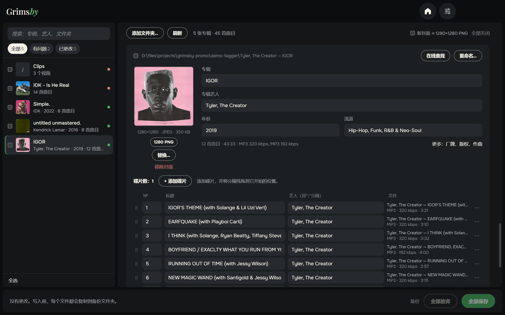
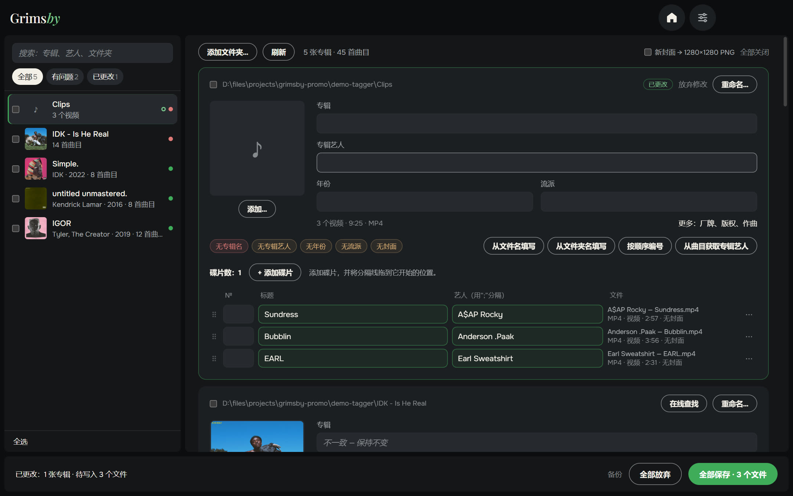
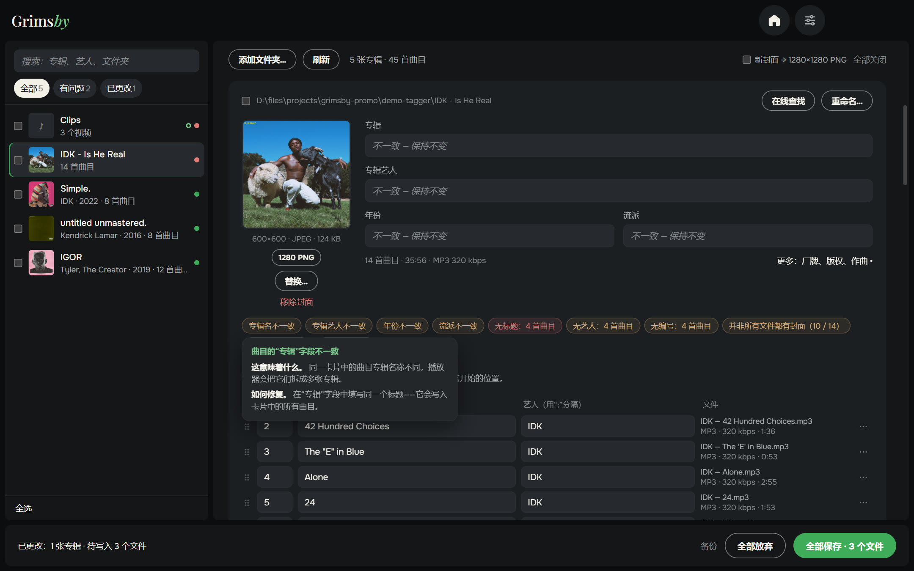
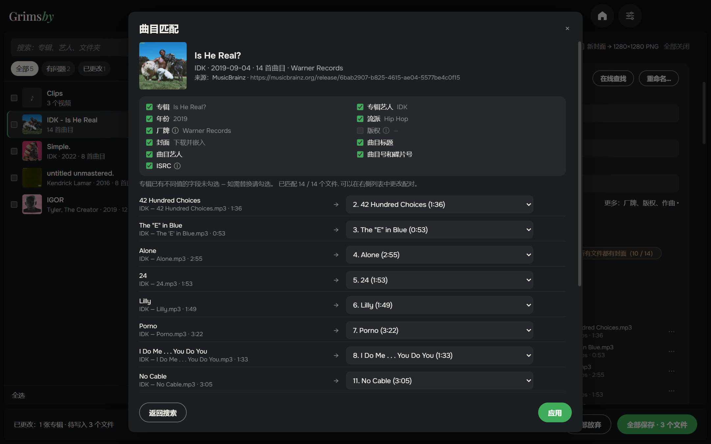
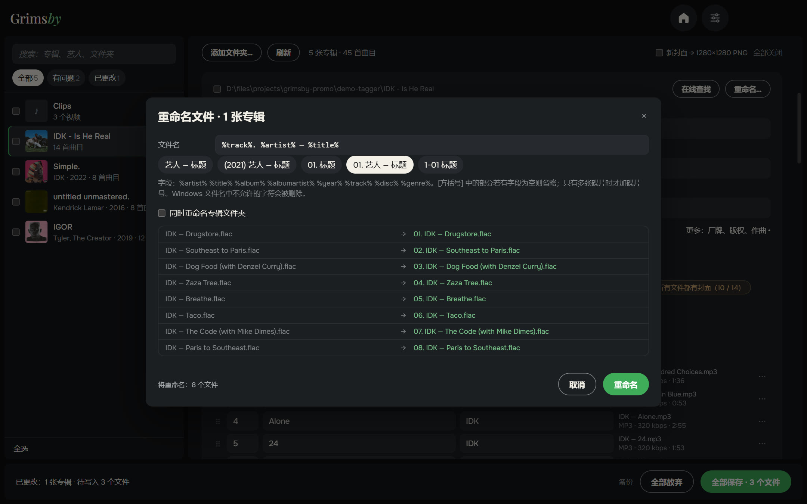
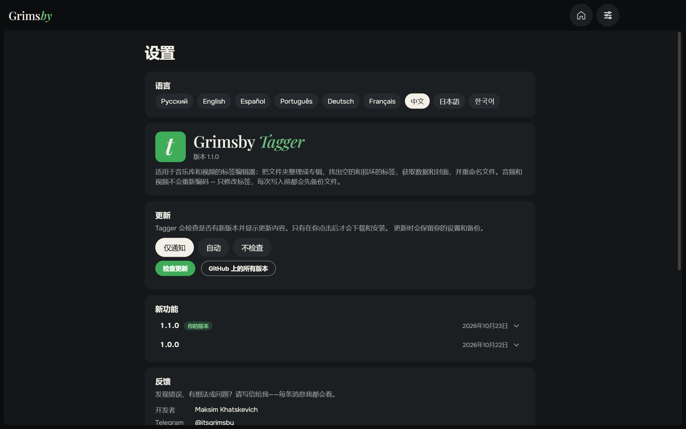
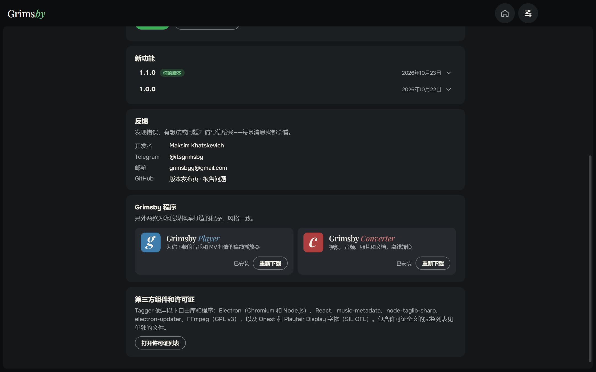

  <a href="README.md">English</a> ·
  <a href="README.ru.md">Русский</a> ·
  <a href="README.es.md">Español</a> ·
  <a href="README.pt.md">Português</a> ·
  <a href="README.de.md">Deutsch</a> ·
  <a href="README.fr.md">Français</a> ·
  <b>中文</b> ·
  <a href="README.ja.md">日本語</a> ·
  <a href="README.ko.md">한국어</a>

  

  <b>整理整个音乐库的标签——按专辑，而不是一个文件一个文件地改。</b> 
  所有问题一目了然，点几下就能修好，一个按钮全部保存。现在也支持视频。

  
  
  
  
  

  <a href="https://github.com/maksimkhatskevich/grimsby-tagger/releases/latest"><b>⬇ 下载 Windows 版</b></a>
  &nbsp;·&nbsp;
  <a href="#功能">功能</a>
  &nbsp;·&nbsp;
  <a href="#你的文件很安全">安全</a>
  &nbsp;·&nbsp;
  <a href="#反馈">反馈</a>

---

## 为什么选择 Grimsby Tagger

标签决定了收藏在播放器里好不好看：正确的专辑、年份、艺人、曲目编号和封面。下载来的音乐很少是完美的——有的专辑没有年份，有的缺封面，有的文字是乱码。传统的标签编辑器只给你一张上千个文件的表格，只能一行一行地改。

**Grimsby Tagger 以专辑为单位。** 选择任意层级的文件夹——它会把文件归入专辑，用带封面的卡片展示每张专辑，并标出有问题的地方。想改什么就改什么，然后点 **全部保存**（Ctrl+S）。

---

## 功能

### 💿 专辑自动整理

专辑 = 文件夹 + “专辑”标签。同一文件夹里的多张专辑会被分开；CD1/CD2 子文件夹会合并成一张；没有标签的文件归入所在文件夹的专辑。同一文件夹里的普通版和豪华版显示为一张卡片。曲目放错了专辑？把它拖到正确的专辑——保存时会套用该专辑的标签和封面，并移动到它的文件夹。

### 🎬 视频也行

MV、演唱会和其他视频的编辑方式和音乐一样，可以批量直接在卡片里修改：MP4、M4V、WMV、MKV、WebM 和 MOV。视频不会重新编码——只更改标签，以及在格式支持时更改封面。

### 🩺 问题一目了然

无法读取的文件、空字段、专辑内不一致的值、重复编号、缺少封面或封面太小、旧编码造成的乱码、损坏的标签。把鼠标移到问题标记上，提示会说明哪里不对、如何修复；**重写标签** 可修复损坏的标签。**“有问题”** 筛选只显示需要处理的专辑。

### 🪄 一键修复

只填写空白内容，绝不覆盖你的数据：

- 根据 `01. 艺人 — 标题` 这样的文件名填写标题、艺人和编号；
- 根据 `艺人 — 专辑 (2021)` 这样的文件夹名填写专辑、艺人和年份；
- 按顺序编号，根据曲目填写专辑艺人；
- 修复编码，嵌入文件夹里的 `cover.jpg`。

### 🌐 在线查找专辑

粘贴音乐服务中的专辑链接，或者直接输入 `艺人 — 专辑`。Grimsby 会在开放的音乐数据库中找到该版本，按标题、时长和编号 **把曲目与你的文件对应起来**，并让你选择要采用哪些字段。专辑中已有不同值的字段默认保持不变。

### ✏️ 按模板重命名

支持 `%artist% — %title%` 或 `[%disc%-]%track% %title%` 这样的模板，也可以同时重命名专辑文件夹。有预览和重名检查，改主意了还能 **撤销重命名**。

### 📦 批量编辑及更多

- 勾选多张专辑 → 一次性设置专辑艺人、年份、流派或厂牌；合并为一张专辑。
- 更多字段：厂牌、版权、作曲、备注、ISRC、歌词。
- 封面：替换、把图片拖到封面上、查看原图、裁成正方形、统一为 1280×1280 PNG，或从找到的版本下载。

### ⚙️ 设置集中在一页

语言、更新（仅提醒、自动或不检查）、更新内容、反馈和其他 Grimsby 应用——全都在一页。窗口会记住大小和位置。

🌍 **9 种语言：** 英语、俄语、西班牙语、葡萄牙语、德语、法语、中文、日语和韩语——在设置中切换，立即生效。

---

## 你的文件很安全

- 只写入标签——**音频和视频都不会重新编码**。
- 编辑前，每个文件都会复制到备份文件夹（保留 14 天）。
- 写入后会重新读取文件。如果打不开或时长变了，会自动恢复原文件。

音乐：MP3、FLAC、M4A（AAC/ALAC）、OGG、Opus、WAV、AIFF、APE、WavPack、WMA 和 DSF。视频：MP4、M4V、WMV、MKV、WebM 和 MOV。

---

## 下载与安装

1. 打开 **[最新版本](https://github.com/maksimkhatskevich/grimsby-tagger/releases/latest)** 页面，下载安装程序 `.exe`。
2. 运行它。Windows 可能会显示蓝色的“Windows 已保护你的电脑”窗口——这是没有付费代码签名证书的程序的正常提示。点击 **更多信息 → 仍要运行**。
   安装程序已在 VirusTotal 上检测：[67 款杀毒引擎均未发现问题](https://www.virustotal.com/gui/file/e4dfabdb0c5f60a9fc7c6c42132a6e3492d6ef2414fcf21a93ebd759987a35e0)（1.1.0 版）。
3. 点击 **添加文件夹…**，或把音乐文件夹拖进窗口。

**系统要求：** Windows 10 或 11（64 位）。 只有在线查找专辑时才需要联网。

---

## 隐私

Grimsby Tagger 在你的电脑上运行。无需账号，没有广告，没有数据分析。只有在你自己查找专辑以及检查更新时才会联网。

---

## Grimsby 应用

<table>
  <tr>
    <td align="center" width="33%"><a href="https://github.com/maksimkhatskevich/grimsby-releases/blob/main/README.zh.md"> <b>Grimsby Player</b></a> 为你下载的音乐和 MV 打造的离线播放器</td>
    <td align="center" width="33%"><a href="https://github.com/maksimkhatskevich/grimsby-converter/blob/main/README.zh.md"> <b>Grimsby Converter</b></a> 视频、音频、照片和文档，离线转换</td>
    <td align="center" width="33%"> <b>Grimsby Tagger</b> </td>
  </tr>
</table>

---

## 反馈

发现了问题、有想法，或者只是想说声谢谢？欢迎联系：

- ✉️ 邮箱: **[grimsbyy@gmail.com](mailto:grimsbyy@gmail.com)**
- 🐞 问题与建议: [Issues](https://github.com/maksimkhatskevich/grimsby-tagger/issues)
- 📣 Telegram：[@itsgrimsby](https://t.me/itsgrimsby)（俄语）

---

## 许可证

Grimsby Tagger 使用了开源组件，包括 Electron、React、music-metadata 和 TagLib#。完整列表及许可证文本见程序文件夹中的 `THIRD_PARTY_NOTICES.txt`。截图中的专辑封面归各自的权利人所有，仅作为个人音乐库的示例。

© 2026 Grimsby

